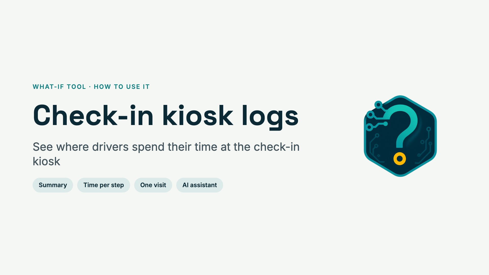
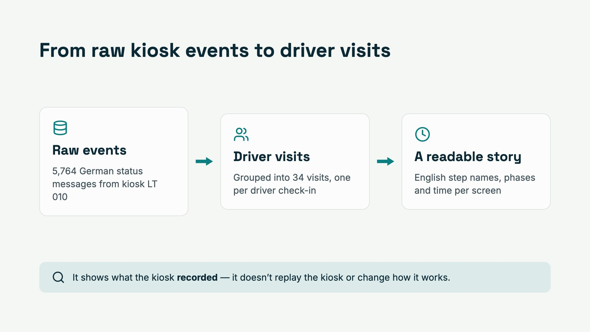
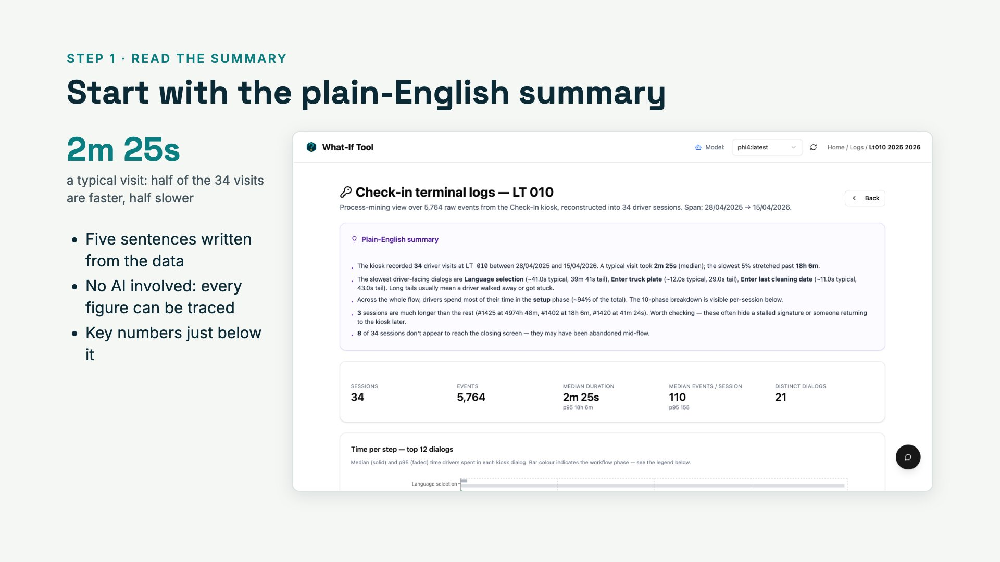
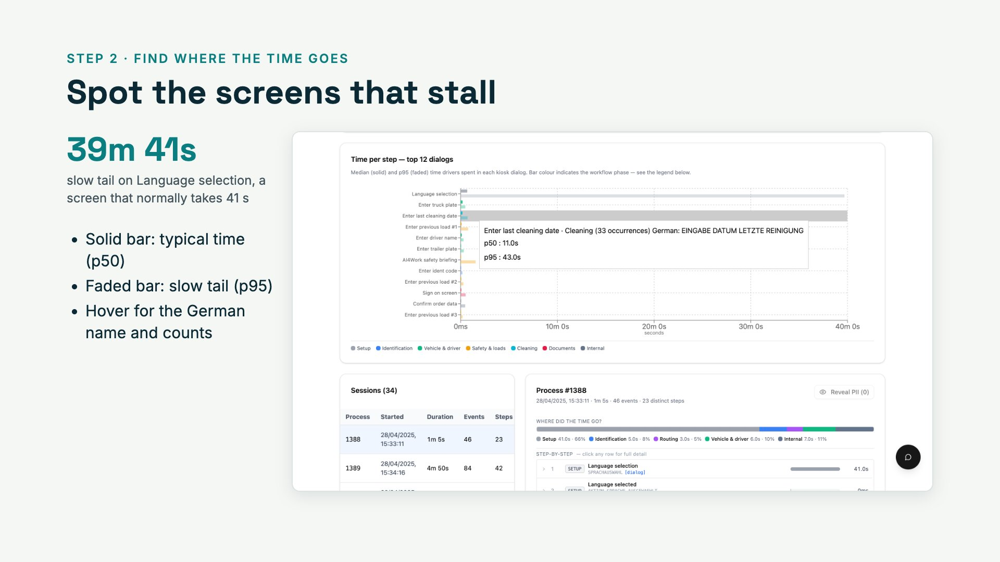
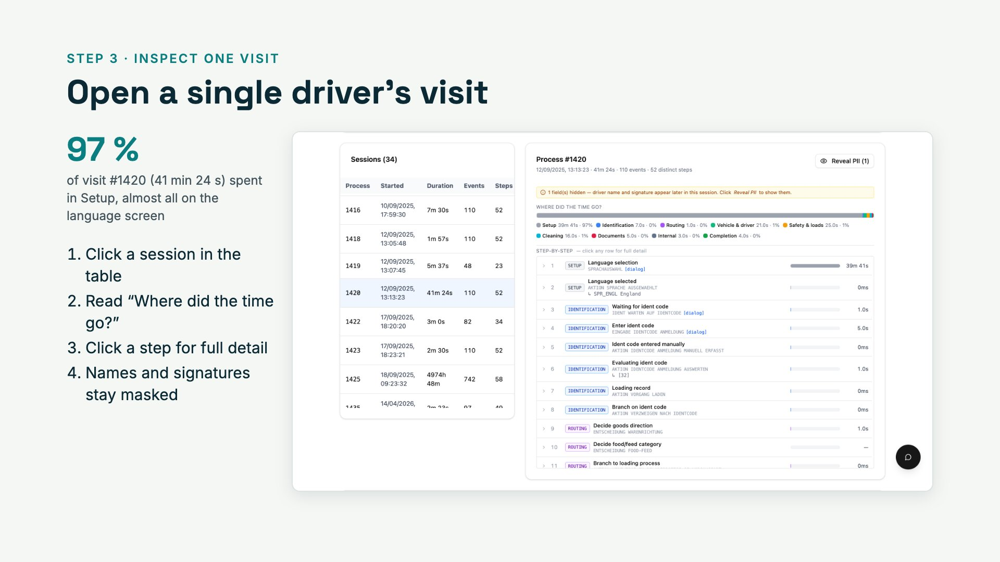
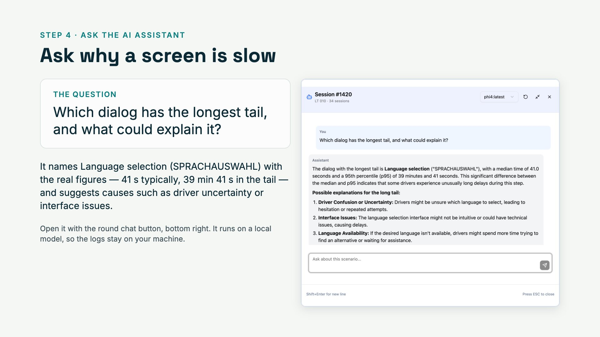
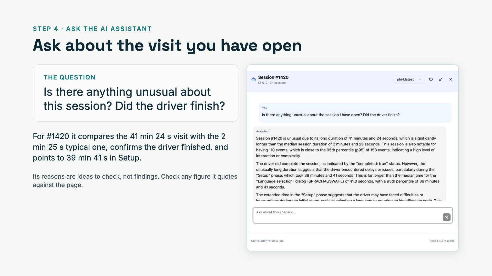
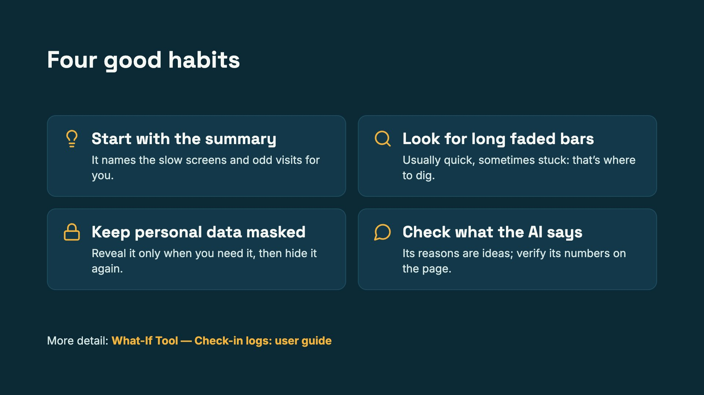

# Check-in logs: how to use it (slides)

What-If Tool — Check-in logs: how to use it — 8 slides. Also available as [PDF](checkin_logs_slides.pdf) and [PowerPoint](checkin_logs_slides.pptx).

## 1. Check-in kiosk logs

**Speaker notes.** This short walkthrough shows how to use the check-in logs view of the What-If Tool. It is for anyone who works with the gate: you will see how to read the summary, find the slow screens, look at a single driver’s visit, and ask the AI assistant for help.

## 2. From raw kiosk events to driver visits

**Speaker notes.** Before a truck enters the yard, the driver checks in at a self-service kiosk: language, ident code, plates, safety rules, signature, pager. The kiosk logs every screen as a German status message — 5,764 of them for kiosk LT 010 between April 2025 and April 2026. The tool groups these into 34 driver visits, translates each step into English, sorts steps into phases and measures how long each screen takes. It is a window on what happened; it doesn’t change the kiosk.

## 3. Start with the plain-English summary

**Speaker notes.** Open the check-in logs page and start at the top. The violet card is a plain-English summary: five sentences calculated straight from the logs, with no AI involved. Here it tells us a typical visit takes two minutes 25 seconds, names the slowest screens, says most time goes into the setup phase, flags three unusually long visits, and warns that 8 of 34 visits never reached the closing screen. Under it, five key numbers give the scale: 34 visits, 5,764 events, the typical duration, events per visit and 21 different screens.

## 4. Spot the screens that stall

**Speaker notes.** The time-per-step chart ranks the twelve screens where drivers spend the most time. The solid bar is the typical time — the median. The faded bar is the slow tail: only five percent of visits take longer. A long faded bar next to a short solid one is the pattern to look for: a screen that is usually quick but sometimes stalls. Here, choosing a language normally takes 41 seconds, but in the slowest visits drivers stay on it for almost 40 minutes. Hover over any bar to see the original German screen name, its phase and how often it occurred.

## 5. Open a single driver’s visit

**Speaker notes.** To understand one driver’s visit, click it in the sessions table. Here we picked visit 1420 from September 2025, which took 41 minutes. The bar at the top of the panel — “Where did the time go?” — splits the visit by phase: 39 minutes 41 seconds, 97 percent, went into setup, almost all on the language screen. Below it, every step is listed with its English and German name; click one to see its exact times and the raw kiosk messages. Driver names and signatures are masked by default; a yellow note tells you how many are hidden, and Reveal PII shows them only when you really need them.

## 6. Ask why a screen is slow

**Speaker notes.** The round button in the bottom-right corner opens the AI assistant. It already knows the key numbers, the slowest screens, the slowest visits and the visit you have open. Here we asked which screen has the longest tail. It answered with the language screen — giving the German name too — quoted the real figures, 41 seconds normally and almost 40 minutes in the slowest visits, and suggested possible causes such as drivers being unsure which language to pick, or interface issues. The model runs locally, so the logs never leave your machine.

## 7. Ask about the visit you have open

**Speaker notes.** The assistant also sees the visit you have open. With visit 1420 selected, we asked whether anything was unusual and whether the driver finished. It compared the 41-minute visit with the typical two and a half minutes, confirmed that the driver did complete the check-in, and pointed to the 39 minutes spent in setup. One caution: the assistant can only see the logs, so its reasons are ideas to check, not findings — and always check any number it quotes against the page.

## 8. Four good habits

**Speaker notes.** Four habits to take away. Start with the summary card — it already names the slow screens and the odd visits. In the time-per-step chart, look for long faded bars: screens that are usually quick but sometimes stall. Keep personal data masked unless you really need it. And treat the AI assistant as a helpful colleague whose ideas you check, not as the final answer. The user guide has every step in more detail.

