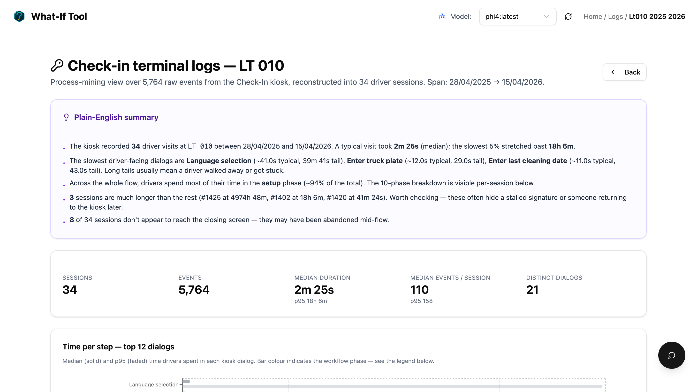
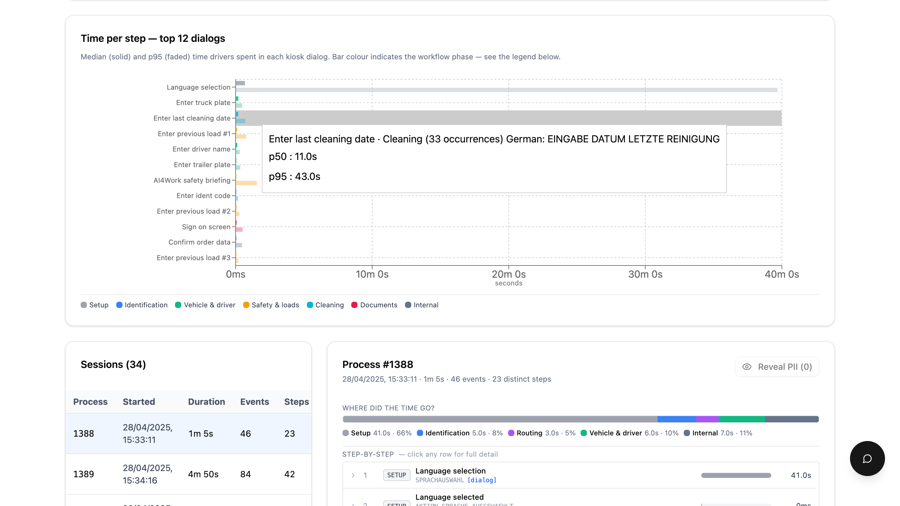
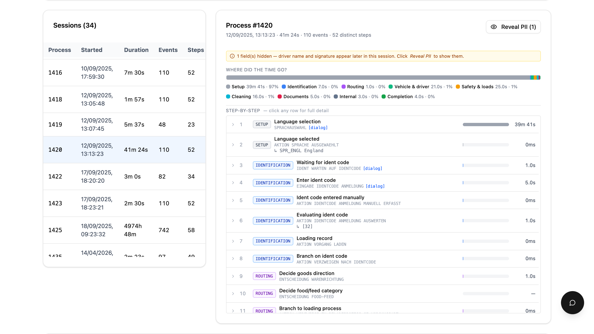
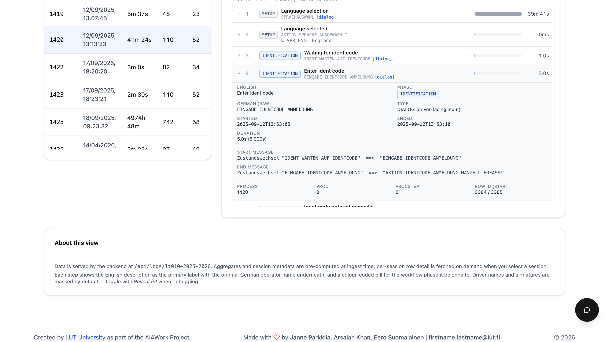
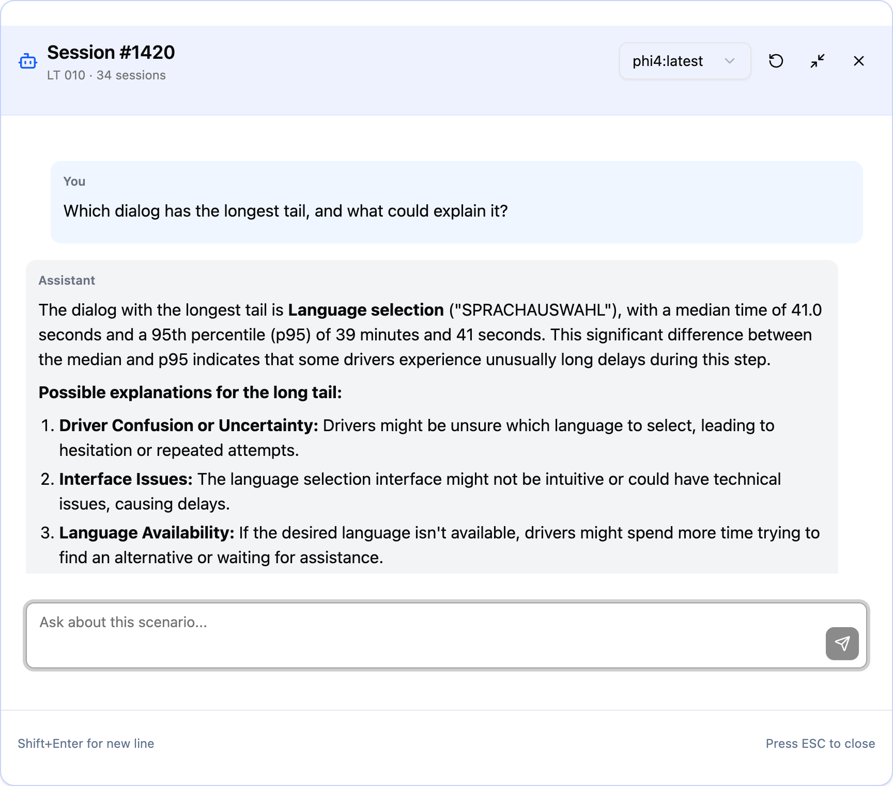
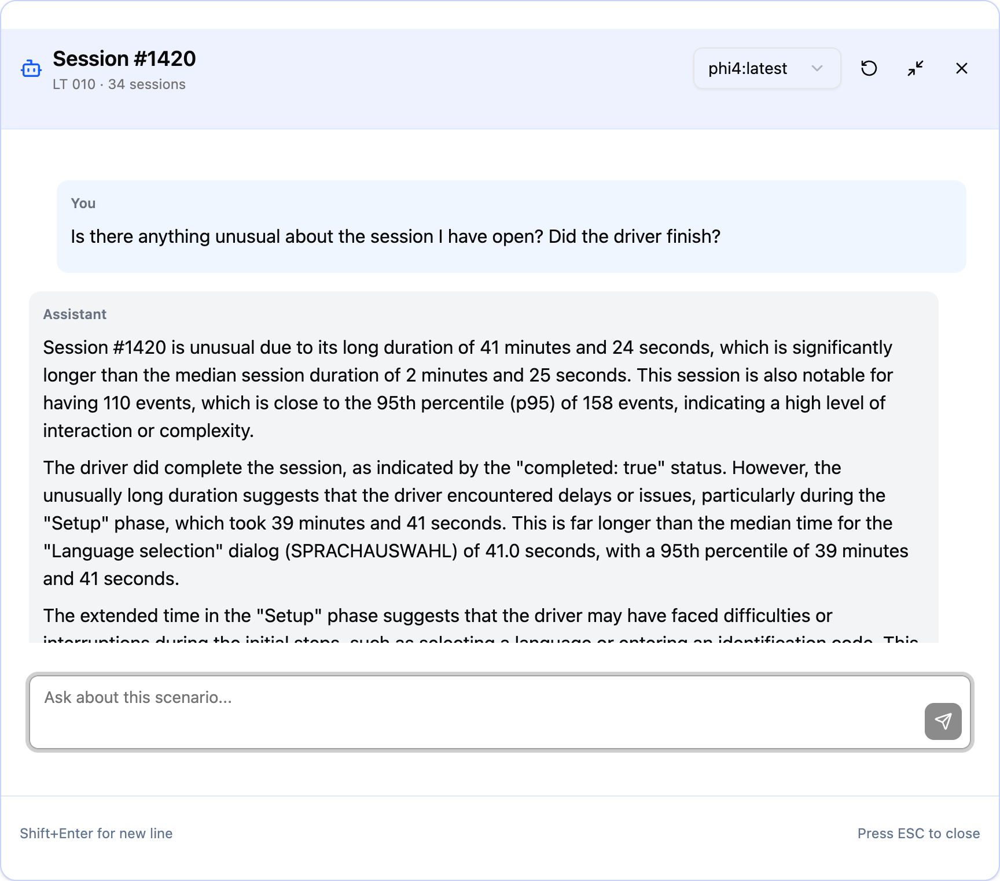

# Check-in kiosk logs: where drivers spend their time

Nov 12, 2026 · Janne Parkkila

## What it does

The check-in logs view turns the raw log of a self-service check-in kiosk into a readable story of each driver’s visit. For the demo kiosk LT 010, it rebuilds 5,764 raw events from 28/04/2025 to 15/04/2026 into 34 driver visits.

Before a truck enters the yard, the driver checks in at the kiosk: picks a language, enters an ident code and licence plates, confirms safety rules, signs and takes a pager. The kiosk logs every screen and every internal step as German status messages. The tool groups those events into visits, translates each step into English, and measures how long drivers spend on each screen.

Use it to answer three questions:

- Where do drivers spend their time at check-in?

- Which screens slow drivers down, normally and in the worst cases?

- Did a particular driver finish, or stop part-way through?

The view shows what the kiosk actually recorded. It does not replay the kiosk or change how it works.

## Read the summary and key numbers

Start with the violet **Plain-English summary** at the top of the page: five sentences that interpret the data for you. They are calculated straight from the logs, with no AI involved, so every figure can be traced back.

For the demo kiosk the summary says:

- A typical visit takes 2 min 25 s; the slowest 5 % of visits stretch past 18 h 6 min.

- The slowest driver-facing screens are Language selection, Enter truck plate and Enter last cleaning date.

- About 94 % of all time is spent in the Setup phase.

- Three visits are far longer than the rest: \#1425, \#1402 and \#1420.

- 8 of the 34 visits never reach the closing screen and may have been abandoned.

Below the summary, a strip of five key numbers gives the scale at a glance.

| Key number | Demo value | What it tells you |
|----|----|----|
| Sessions | 34 | Driver visits rebuilt from the log |
| Events | 5,764 | Raw kiosk log entries |
| Median duration | 2m 25s (p95 18h 6m) | How long a typical visit takes; p95 = only 5 % take longer |
| Median events / session | 110 (p95 158) | How much a typical visit logs |
| Distinct dialogs | 21 | Different screens drivers saw |

## Find where the time goes

The **Time per step** chart ranks the 12 kiosk screens where drivers spend the most time. Each screen has two bars: the solid bar is the typical time (the median, p50) and the faded bar is the slow tail (p95: only 5 % of visits take longer). The bar colour shows the workflow phase.

1.  Look for a long faded bar next to a short solid one. That screen is usually quick but sometimes stalls, which often means a driver got stuck or stepped away.

2.  Hover over a bar to see the screen’s phase, how often it occurred, its original German name and both times.

3.  Compare what you see with the summary’s list of slowest screens.

The three slowest screens in the demo data:

| Screen                   | Phase            | Typical (p50) | Slow tail (p95) |
|--------------------------|------------------|---------------|-----------------|
| Language selection       | Setup            | 41.0 s        | 39 min 41 s     |
| Enter truck plate        | Vehicle & driver | 12.0 s        | 29.0 s          |
| Enter last cleaning date | Cleaning         | 11.0 s        | 43.0 s          |

Language selection stands out: normally under a minute, but in the slowest visits the driver stays on it for almost 40 minutes.

## Inspect one driver visit

The **Sessions** table on the left lists every visit with its start time, duration, number of events and steps, and the licence plate when one was captured. The panel on the right shows the visit you select.

1.  Click a row in the Sessions table, for example \#1420: a 41 min 24 s visit on 12/09/2025.

2.  Read **Where did the time go?** at the top of the panel: one bar split by phase, with the time and share of each. For \#1420, Setup took 39 min 41 s, 97 % of the visit, almost all of it on the language screen.

3.  Scan the **step-by-step** list. Each step shows its phase tag, its English name with the German kiosk name underneath, and a bar for how long it took.

4.  Click any step to expand it. You see the exact start and end times, the duration, whether it was a driver-facing dialog or an internal action, and the raw kiosk messages.

5.  Check whether the driver finished. A visit that reached the closing screen (Show closing screen, German: ANZEIGE SCHLUSSBILD) is complete; one that never got there may have been abandoned.

Personal data stays hidden by default. The driver’s name and signature appear masked, showing only their first and last two characters, and a yellow note says how many fields are hidden. **Reveal PII** shows them when you genuinely need them for troubleshooting; click it again to hide them.

## Ask the AI assistant

The AI assistant answers questions about the logs in plain English, using the page’s own numbers. It runs on a local model (phi4 via Ollama) on your machine, so the logs never leave it. Open it with the round chat button in the bottom-right corner; the expand button makes it larger, and Esc closes it.

The assistant already knows the key numbers, the slowest screens, the five slowest visits and the visit you have open, including its time per phase. It is instructed to answer in English, to give the German screen name in brackets, to separate typical (p50) from slow-tail (p95) times, and never to repeat masked personal data.

Questions that work well:

- “Which dialog has the longest tail, and what could explain it?” In the demo it names Language selection (SPRACHAUSWAHL): 41 s typically, 39 min 41 s in the tail, and suggests driver uncertainty or interface issues.

- “Is there anything unusual about the session I have open? Did the driver finish?” For \#1420 it points to the 39 min 41 s spent in Setup and confirms the visit completed.

- “Which screen would benefit most from a design change?”

Treat its explanations as ideas to check, not findings. It can only see the logs, so it cannot know why a driver paused, and it can misread a number. Check any figure it quotes against the page before you act on it. Reset the conversation with the circular-arrow button to start a fresh topic.

## Quick reference

The tool sorts every kiosk step into one of nine workflow phases, shown by colour in the charts and as a tag in the step list. Steps it cannot place appear as Other.

| Phase | Colour | Example steps |
|----|----|----|
| Setup | Grey | Initialisation, Language selection |
| Identification | Blue | Waiting for ident code, Enter ident code, Evaluating ident code |
| Routing | Purple | Decide goods direction, Decide food/feed category |
| Vehicle & driver | Emerald | Enter truck plate, Enter trailer plate, Enter driver name |
| Safety & loads | Amber | Acknowledge PPE rules, Acknowledge site rules, Enter previous load \#1–#3 |
| Cleaning | Cyan | Enter last cleaning date, Cleaning certificate available? |
| Documents | Rose | Scan documents, Sign on screen |
| Internal | Slate | Save record, Set record status, Confirm order data |
| Completion | Green | Hand out pager, Show closing screen |

| Term | Meaning |
|----|----|
| Session (visit) | One driver’s complete use of the kiosk, from first screen to last |
| Event | One raw log entry; each step logs a start and usually an end |
| Dialog | A screen where the driver has to do something, such as type a plate |
| Typical time (p50) | The median: half of the visits are faster, half slower |
| Slow tail (p95) | Only 5 % of visits take longer than this |
| Completed | The visit reached the closing screen (ANZEIGE SCHLUSSBILD) |
| PII | Personal data: here the driver’s name and signature, masked by default |
