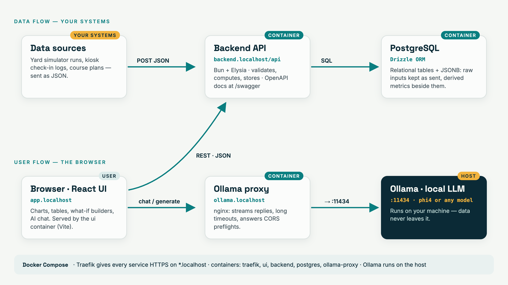
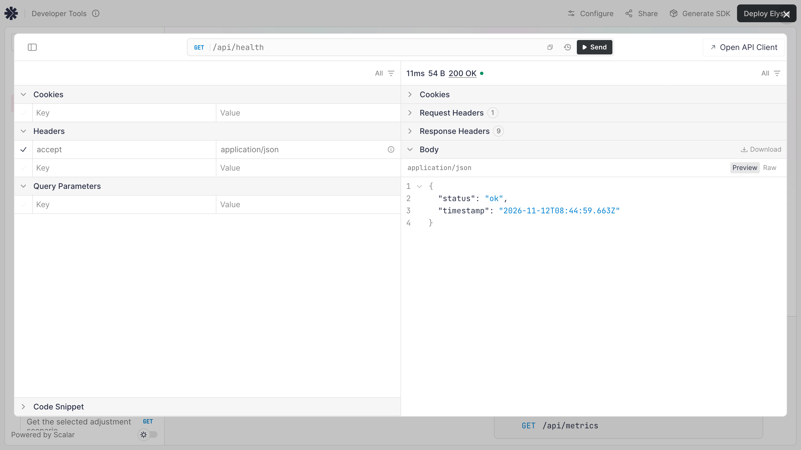
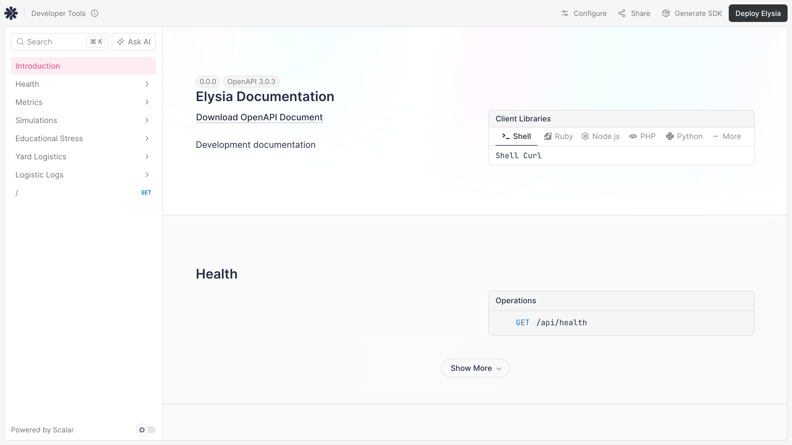
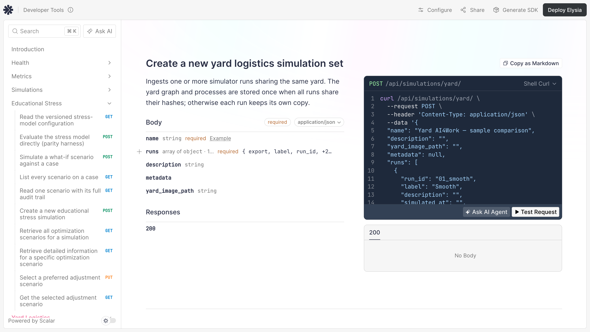

# What-If Tool: developer guide

Nov 12, 2026 · Janne Parkkila

## Architecture at a glance

The What-If Tool is a React app in the browser over a REST API (Bun + Elysia) and PostgreSQL. The AI is a local Ollama model that the **browser** calls through an nginx proxy — the backend never calls an LLM.

Data moves in two flows:

- **Data flow.** Your systems (a yard simulator, a kiosk, a course-planning tool) `POST` JSON to the API. The backend validates it, computes results, and stores both the raw input and the derived metrics.

- **User flow.** The browser loads the app, reads results over REST, and sends chat and generation requests straight to Ollama with the page's data as context.



| Component | What it does | Local address | Where in the repo |
|----|----|----|----|
| UI | React 19 + Vite. Charts, what-if builders, proposal workflow, AI chat — and every LLM call | `https://app.localhost` | `ui/` |
| Backend API | Bun + Elysia. Validates input, runs the models and analytics, stores results. OpenAPI docs at `/swagger` | `https://backend.localhost/api` | `backend/` |
| PostgreSQL 18 | Relational tables with JSONB columns, read through Drizzle ORM | host port 5433 | `db/schema.sql`, `backend/src/db/schema.ts` |
| Ollama proxy | nginx. Streams replies, 20-minute timeouts, answers CORS preflights | `https://ollama.localhost/api` | `ollama_proxy/nginx.conf` |
| Ollama | The local LLM. Runs on the host, not in Docker | `:11434` on the host | — |
| Traefik | HTTPS on `*.localhost` with mkcert certificates | ports 80 and 443 | `traefik/` |

Three domains share this stack: **education** (course-stress what-ifs), **yard logistics** (simulator runs and AI proposals) and **check-in kiosk logs** (process mining). An older coursework model is kept for compatibility.

## Run it locally

The whole stack runs with Docker Compose on one machine; Ollama runs beside it on the host. You need Docker, Bun 1.4.0 (the images pin it and share lockfiles with the host), mkcert certificates for `*.localhost` (committed under `traefik/certs/`, or regenerate them) and Ollama.

```sh
# 1. Build the three images (backend, ui, ollama-proxy)
./build_docker_images.sh

# 2. Start Ollama on the host with the two required variables, then pull a model
OLLAMA_HOST=0.0.0.0 \
  OLLAMA_ORIGINS='https://app.localhost,https://backend.localhost' \
  ollama serve
ollama pull phi4

# 3. Start the stack; schema.sql and seed.sql run on the first boot only
docker-compose up -d

# 4. Load the demo yard and kiosk-log cases
docker-compose exec backend bun run seed:yard
docker-compose exec backend bun run seed:logs

# 5. Check it
curl -k https://backend.localhost/api/health   # {"status":"ok","timestamp":"…"}
```

Then open `https://app.localhost` for the app and `https://backend.localhost/swagger` for the live API reference.



| Variable | Read by | Purpose |
|----|----|----|
| `DATABASE_URL` | backend | PostgreSQL connection string. Required; the backend refuses to start without it |
| `PORT` | backend | Listen port, default 8000 |
| `APP_BASE_URL` | backend | Base of the `resultsUrl` that every create endpoint returns |
| `SERVER_URL` | backend | Public base for uploaded yard images |
| `LOG_LEVEL` | backend | Winston log level |
| `VITE_BACKEND_API_URL` | UI | Backend base **including `/api`**, e.g. `https://backend.localhost/api` |
| `VITE_OLLAMA_API_URL` | UI | LLM base, e.g. `https://ollama.localhost/api` |

Postgres listens on host port **5433**, not 5432. `JWT_SECRET` appears in the compose file but nothing reads it.

## The REST API

Every endpoint lives under `/api` and speaks JSON; the live reference with request schemas and ready-made `curl` commands is at `/swagger` (raw OpenAPI 3.0 at `/swagger/json`, 34 operations). Each domain follows the same pattern: **create a case** with one POST, **read** it back by `caseId`, add to it, and **mark a preferred** option.



**Education** — prefix `/api/simulations/education`

| Method | Path | Purpose |
|----|----|----|
| POST | `/` | Create a case from a course definition: builds the weekly schedule, the baseline and four generated scenarios |
| GET | `/:caseId` | The whole case, every scenario included |
| POST | `/:caseId/scenarios` | Run a what-if (a list of typed adjustments); the result is stored |
| GET | `/:caseId/scenarios?origin=generated|user` | List scenarios |
| GET | `/:caseId/scenarios/:scenarioId` | One scenario with its full audit trail |
| PUT | `/:caseId/select` | Mark the preferred scenario (`{"adjustmentId"}`) |
| GET | `/:caseId/selection` | Read the selection |
| GET | `/stress-model` | The model's versioned constants, thresholds and build order |
| POST | `/stress-model/evaluate` | Run weeks through the model and get every component back; nothing is stored |

**Yard logistics** — prefix `/api/simulations/yard`

| Method | Path | Purpose |
|----|----|----|
| POST | `/` | Create a case from one or more simulator runs |
| POST | `/:caseId/runs` | Add one run to an existing case — the webhook target for a simulator |
| GET | `/:caseId` | Overview: yard graph, processes and every run's summary metrics |
| GET | `/:caseId/:runId` | One run in full: orders, measurements, summary |
| GET | `/:caseId/:runId/timeline?entity=LT010` | Occupancy of one entity in 30-second buckets, computed on request |
| PUT / GET | `/:caseId/select`, `/:caseId/selection` | Mark and read the preferred run |
| POST / DELETE | `/:caseId/image` | Upload (multipart, PNG/JPEG/WebP/SVG, ≤ 5 MB) or remove the yard map |
| GET / POST | `/:caseId/proposals` | List proposals, or save one (validated against the yard) |
| DELETE | `/:caseId/proposals/:id` | Delete a proposal |



**Check-in kiosk logs** — prefix `/api/logs`

| Method | Path | Purpose |
|----|----|----|
| POST | `/` | Ingest a batch of kiosk rows; aggregates are computed at ingest |
| GET | `/:caseId` | Overview and per-step aggregates |
| GET | `/:caseId/aggregates` | Aggregates only |
| GET | `/:caseId/sessions` | Driver visits, rebuilt from the rows when read |
| GET | `/:caseId/sessions/:processId` | One visit with its raw rows |
| POST | `/:caseId/recompute` | Re-run the analytics over stored rows |
| DELETE | `/:caseId` | Delete the case and its rows |

Platform endpoints: `GET /api/health` (liveness only — no database or AI check), `GET /api/metrics` (Prometheus), and the older coursework model at `POST /api/simulations/` and `GET /api/simulations/:caseId`.

**Rules that hold everywhere**

- **Create returns a link.** Every create answers `201` with the new `caseId` and a `resultsUrl` that opens the case in the app.

- **Two kinds of rejection.** A body that breaks the schema gets `422` from Elysia with a `{type:"validation", …}` body. A body that is well-formed but wrong gets `400` from the service with `{error, message}` — for example a double-serialized yard export.

- **No authentication.** The API has no auth and CORS reflects any origin. Put it behind your own gateway before exposing it beyond a trusted network.

- **Not built yet.** Forwarding a proposal to the simulator (`POST /:caseId/proposals/:id/run`) is described in the yard specification but not implemented; the UI button is disabled.

## JSON in, JSON out

The contract follows one idea: **accept the data in the shape its owner produces, keep it as sent, and compute what the app needs beside it.** Partner formats are wrapped, not rewritten; results come back with enough detail to audit them.

**Yard: a thin wrapper around the simulator's own export.** Your request names the case and lists runs; each run's `export` is the simulator's `SimulationExportData`, passed through untouched.

```json
// POST /api/simulations/yard/   (from specifications/examples/yard_logistics/01_create_simulation.minimal.json, trimmed)
{ "name": "Minimal yard example",
  "runs": [ { "run_id": "minimal_smooth", "label": "Minimal", "simulated_at": "2026-01-01T10:00:00Z",
    "export": {
      "ComparisonInformation": { "YardStructure": "…", "Processes": "…", "Orders": "…" },
      "YardStructure": { "Entities": { "Terminals": [ … ], "Storages": [ … ] }, "Streets": [ … ] },
      "Processes": [ … ], "Orders": [ … ],
      "Measurements": { "Summary": { … }, "Measurements": [ … ] } } } ] }
// → 201 { "caseId": "…", "runCount": 1, "resultsUrl": "https://app.localhost/yard/…" }
```

The backend checks the four parts it reads and explains a malformed export instead of failing:

```json
// 400 — the export was sent as a JSON string instead of an object
{ "error": "Invalid simulation payload.",
  "message": "runs[0].export is a JSON string, but must be the SimulationExportData JSON object itself. It looks double-serialized — embed the parsed object instead of a serialized string." }
```

The overview (`GET /:caseId`) returns each run's `summary_metrics`, computed once at ingest: orders, waiting and driving statistics (total, avg, max, p95), throughput, and the top five `bottlenecks` with a `queue_score` (peak trucks present ÷ capacity).

**Education: a course definition in, an auditable scenario out.** The create body describes the course — dates, sessions, assignments with hours, exams, optional observed stress — and the current week. A what-if is a named list of typed adjustments:

```json
// POST /api/simulations/education/{caseId}/scenarios   (04_create_scenario.json, trimmed)
{ "name": "Move the exam and ease the run-up",
  "adjustments": [
    { "id": "adj-001", "type": "move_exam", "exam_id": "exam-1", "new_date": "2026-11-17T09:00:00Z" },
    { "id": "adj-003", "type": "move_homework", "source_week_index": 11, "target_week_index": 5, "hours": 6.0 } ],
  "options": { "redistribution_objective": "trajectory_peak" } }
```

The result says what happened to each adjustment and whether the scenario helped, so a client never has to infer it:

```json
// 201 response (trimmed)
{ "stress_model_version": "1.0",
  "baseline":   { "summary": { "peak_stress": 59.95, "peak_week_number": 11 } },
  "simulation": { "summary": { "peak_stress": 60.09, "peak_week_number": 12 } },
  "objective":  { "peak_stress_delta": 0.14, "moved_workload_hours": 26.2, "improved": false },
  "adjustment_outcomes": [ { "adjustment_id": "adj-001", "status": "applied", "code": "ok" } ],
  "redistribution_flows": [ { "source_week_number": 10, "target_week_number": 11, "hours": 3 } ] }
```

A `201` does not mean every adjustment worked: each outcome is `applied`, `partially_applied` or `rejected` with a machine-readable `code`. Scenarios also carry `weekly_results` with the seven model components per week.

**Check-in logs: the kiosk's rows, unchanged.** Each row is one Start or End event as the kiosk logged it (German step names included); visits are rebuilt from the `process` id.

```json
// POST /api/logs/   (01_create_case.json, one row shown)
{ "name": "Minimal LT 010 example", "location": "LT 010", "topic": "Check-In",
  "rows": [ { "id": 2, "date": "2026-01-01T08:00:00", "process": 9001, "proc": 1, "procstep": 1,
      "procsteptype": "DIALOG", "procstepinfo": "SPRACHAUSWAHL", "procstepaction": "Start",
      "message": "Display language picker", "value": "" } ] }
// GET /api/logs/{caseId}/sessions → [{ "processId": 1388, "durationSec": 65, "eventCount": 46, "completed": false, … }]
```

**Ready-made bodies.** Every example below is in `specifications/examples/` and doubles as an integration-test fixture.

| File | Use it to |
|----|----|
| `education/03_create_simulation_v1.json` | Create the CS-220 demo course |
| `education/04_create_scenario.json` | Run a four-adjustment what-if that does not help |
| `yard_logistics/01_create_simulation.minimal.json` | Learn the export shape (≈ 7 KB, one truck) |
| `yard_logistics/05_full_three_runs.json` | Recreate the three-run demo (≈ 900 KB) |
| `yard_logistics/03_create_proposal.json` | Save a manual proposal |
| `logistic_logs/01_create_case.json` | Ingest a nine-row kiosk session |
| `logistic_logs/02_full_year_lt010.json` | Recreate the LT 010 demo (5,764 rows) |

## The database

PostgreSQL holds 11 tables. The design rule: **relational columns for what you query and join on, JSONB for nested data you read whole** — partner formats stored exactly as received, audit trails, and metrics computed once at ingest so pages load without recomputing.

| Table | One row is | Kept as JSONB | Derived at write time |
|----|----|----|----|
| `educational_simulations` | an education case | course definition, assignments, exams, baseline schedule, observed stress, model version block | baseline schedule and trajectory |
| `adjustment_scenarios` | a generated or user scenario (`origin` column) | week schedules, adjustments, outcomes, redistribution flows, comparison, warnings | `summary_metrics` |
| `yard_simulations` | a yard case (one yard, many runs) | yard graph and processes, stored once when runs share them | — |
| `yard_runs` | one simulator run | raw `orders` and `measurements`; its own yard graph only if it differs | `summary_metrics` (KPIs, bottlenecks) |
| `yard_proposals` | an AI or manual improvement | `changes` (a typed union, easy to extend) | — |
| `log_cases` | a batch of kiosk logs | metadata | `summary_metrics` (overview and per-step aggregates) |
| `log_rows` | one kiosk event | — (flat fact table) | — |
| `simulation_sets`, `scenarios`, `assignments`, `stress_metrics` | the older coursework model | — | — |

Child tables reference their case with `ON DELETE CASCADE`, so deleting a case removes everything under it.

**Raw versus derived, per domain**

- **Yard.** Orders and measurements are stored verbatim; KPIs and bottlenecks are computed once at ingest. Occupancy timelines are never stored — they are computed per request. Runs share the parent's yard graph when the layouts match after ignoring silo stock levels, which change every run; the simulator's original hashes are kept for reference.

- **Logs.** Rows are inserted in chunks of 1,000; visits are rebuilt from rows when read. After changing the analytics code, `POST /:caseId/recompute` refreshes the stored aggregates.

- **Education.** The baseline and the four generated scenarios are written when the case is created; every user scenario is stored with its full audit trail.

**Model versioning.** Education cases carry the stress model's version. Cases from before model 1.0 are tagged `legacy-0`, still render with the old calculator, and are never recomputed; posting a scenario to one returns `409`.

**Changing the schema** — the schema lives in two synced places, and there is no auto-migration:

1.  Edit `db/schema.sql` (the canonical SQL; Postgres runs it on the first boot of an empty volume).

2.  Mirror the change in `backend/src/db/schema.ts` (Drizzle tables and relations used at runtime).

3.  For existing databases, add an idempotent `db/<name>_migration.sql` — `CREATE TABLE IF NOT EXISTS`, `ADD COLUMN IF NOT EXISTS`, guarded `DO $$ … $$` blocks — and apply it:

```sh
docker-compose exec -T postgres psql -U whatifuser -d whatifdatabase < db/<name>_migration.sql
```

## The LLM layer

All AI runs from the browser through **one file**, `ui/src/services/ollamaService.ts`, wrapped by the `useOllama` hook; every feature builds its own prompt from data the page has already loaded. Nothing LLM-related is stored on the server, and each chat message rebuilds its context from scratch.

The service uses three Ollama endpoints under `VITE_OLLAMA_API_URL`: `GET /tags` (list models), `POST /chat` (streamed as NDJSON for chats, non-streamed for proposals) and `POST /generate` (only the older explanation box). A chat request looks like this:

```json
// POST https://ollama.localhost/api/chat
{ "model": "phi4:latest",
  "messages": [
    { "role": "system", "content": "<role and rules> + <case data rendered as text>" },
    { "role": "user", "content": "Which dialog has the longest tail, and why?" } ],
  "stream": true,
  "options": { "temperature": 0.3, "num_predict": 1024 } }
```

| Feature | Component | Call and options | What goes into the context |
|----|----|----|----|
| Education chat | `components/stress/FloatingStressChat.tsx` | streamed chat, model only | Course, assignments, exams, how to read the score, scenario comparison, changed weeks with their top components |
| Yard chat and "Discuss" | `components/yard/FloatingYardChat.tsx` | streamed chat, model only | Yard layout, every run's KPIs and top bottlenecks, the focused run, and the proposal under discussion |
| Yard proposal generation | `components/yard/GenerateProposalsPanel.tsx` + `yardProposalPrompt.ts` | non-streamed chat, `temperature 0.3`, `num_predict 2048`, deliberately no `format: "json"` | A JSON-only contract with the change schema, plus the target run's KPIs and saturated bottlenecks |
| Logs chat | `components/logisticLogs/FloatingLogsChat.tsx` | streamed chat, `temperature 0.3`, `num_predict 1024` | Overview, top 20 dialogs with English glosses, slowest visits, the visit in focus, a never-quote-personal-data rule |

**Model selection.** On load, `ModelContext` lists the installed models and defaults to the first; the choice is stored in the browser and shown in the top-bar picker. Any model you `ollama pull` appears there.

**From model text to a saved proposal.** Models do not always return clean JSON, so the pipeline is tolerant first and strict last:

1.  `parseProposalResponse` strips `<think>` blocks and code fences, then tries whole-document JSON, a bracketed array, and finally a brace-by-brace walk.

2.  Entries without a title, summary and at least one known change kind are dropped; if nothing survives, the user sees a "couldn't be parsed" error.

3.  Drafts live in the browser's localStorage until saved.

4.  Saving calls `POST /:caseId/proposals`, where `validateProposal` checks every entity against the yard. It does not check numbers — a draft can name a real terminal with a wrong current capacity — so drafts need a human review.

**The proxy and the host.** nginx forwards `ollama.localhost` to `host.docker.internal:11434` with buffering off (for streaming) and 1,200-second read and send timeouts. It answers CORS preflights itself, but real responses carry only Ollama's own CORS headers. Ollama must therefore run with `OLLAMA_HOST=0.0.0.0` (otherwise the proxy gets 502) and `OLLAMA_ORIGINS` listing `https://app.localhost` (otherwise Ollama answers the browser with 403).

## Choose your own LLM and backend

The LLM is swappable at three levels; how much work it takes depends on how far the new one is from Ollama's API.

| You want | Work needed | What to change |
|----|----|----|
| A different Ollama model (Llama, Mistral, Qwen, gpt-oss…) | None | `ollama pull <model>` on the host; pick it in the top-bar model picker |
| Another server that speaks Ollama's API, or Ollama on another machine | Configuration | Change `proxy_pass` in `ollama_proxy/nginx.conf` and restart the proxy, or point `VITE_OLLAMA_API_URL` at it (that server must then send CORS headers for the app's origin) |
| An OpenAI-compatible server (vLLM, LM Studio, llama.cpp) or a hosted API (OpenAI, Anthropic Claude) | One adapter file | Re-implement `ui/src/services/ollamaService.ts`, keeping its exported functions so the hook and every feature keep working |

Models that "think" before answering can hang on the strict JSON task of proposal generation; phi4, a non-reasoning model, is the tested choice there (the setup notes warn that gpt-oss with thinking enabled can hang too). Any model works for chat.

**The adapter: four functions.** Keep the signatures; change what is behind them.

| Function | Used by | Must return |
|----|----|----|
| `listModels(signal?)` | the model picker | `{ models: [{ name }] }` — from `GET /v1/models` on OpenAI-style servers |
| `streamChatCompletion(params, callbacks, signal?)` | every chat | tokens through `callbacks.onToken`, the full text through `onComplete`; honour the `AbortSignal` (the Stop button) |
| `chatCompletion` / `syncChat` | proposal generation | the assistant's text, non-streamed |
| `streamCompletion` / `generateCompletion` | the older explanation box | map `{system, prompt}` to a two-message chat |

Map the options as you go: `temperature` stays `temperature`, `num_predict` becomes `max_tokens` (required by Anthropic's Messages API), and `format` can be ignored — no caller sets it. Anthropic's native API also takes `system` as a top-level field rather than a message.

```ts
// Sketch, not in the repo: an OpenAI-compatible streamChatCompletion
export async function streamChatCompletion(params: ChatParams, cb: StreamCallbacks, signal?: AbortSignal) {
  cb.onStart?.();
  const res = await fetch(`${LLM_BASE}/chat/completions`, {             // e.g. http://localhost:8080/v1
    method: "POST", signal, headers: { "Content-Type": "application/json" },
    body: JSON.stringify({ model: params.model, messages: params.messages, stream: true,
      temperature: params.options?.temperature, max_tokens: params.options?.num_predict }) });
  if (!res.ok || !res.body) return cb.onError?.(new Error(`LLM returned ${res.status}`));
  const reader = res.body.getReader(), dec = new TextDecoder();
  let buf = "", full = "";
  for (let r = await reader.read(); !r.done; r = await reader.read()) {
    buf += dec.decode(r.value, { stream: true });
    const lines = buf.split("\n"); buf = lines.pop() ?? "";
    for (const line of lines) {                                          // server-sent events: "data: {...}"
      const data = line.startsWith("data: ") ? line.slice(6).trim() : "";
      if (!data || data === "[DONE]") continue;
      const token = JSON.parse(data).choices?.[0]?.delta?.content ?? "";
      if (token) { full += token; cb.onToken?.(token); }
    }
  }
  cb.onComplete?.(full);
}
```

**Keep API keys out of the browser.** Anything in a `VITE_*` variable is compiled into the JavaScript bundle and readable by every user. For a hosted provider, add the key on the server side instead:

- **In the nginx proxy:** set the `Authorization` header with `proxy_set_header`, and add CORS headers to real responses (today only preflights get them). The proxy has no auth, so anyone who can reach it spends your key.

- **In the backend:** add a route such as `/api/llm/chat` that calls the provider with a key from the environment. This route does not exist yet, and the API has no auth either, so add authentication and rate limits first.

Moving to a hosted model also moves data: prompts contain case data — course plans, yard KPIs, kiosk sessions including the visit's licence plate. Check that this is allowed before switching.

**Running the backend somewhere else.** The API is a plain Bun process:

1.  Provide `DATABASE_URL` and apply `db/schema.sql` to the new database.

2.  Set `APP_BASE_URL` (used in every `resultsUrl`) and `SERVER_URL` (used for uploaded images).

3.  Give the UI `VITE_BACKEND_API_URL` **with** the `/api` suffix — several services fall back to `http://localhost:8000` without it.

4.  Restrict CORS by passing options to `cors()` in `backend/src/index.ts`; it currently accepts any origin with credentials.

5.  Keep `uploads/yard_images/` on persistent storage; it is relative to the process's working directory.

## Extend the tool

Each domain is a vertical slice — tables, types, services, routes, a UI page and a chat — so new work copies an existing slice. The check-in logs domain is the newest and the cleanest one to copy.

**Add a new use case end to end**

1.  **Tables.** Add them to `db/schema.sql` and write an idempotent `db/<name>_migration.sql` (copy `db/log_cases_migration.sql`).

2.  **Drizzle.** Mirror the tables and their `relations()` in `backend/src/db/schema.ts`.

3.  **Types.** Create `backend/src/types/<domain>.ts` and a copy in `ui/src/types/<domain>.ts`; the two are kept in sync by hand.

4.  **Services.** Put analytics in pure functions with no database import (easy to unit-test), and ingest in a service that writes in a transaction (copy `logAnalyticsService.ts` and `logIngestService.ts`).

5.  **Routes.** Create `new Elysia({ prefix: "/<domain>" })` with TypeBox bodies and a `detail.tags` entry so it shows in Swagger, then register it in `backend/src/routes/index.ts` — static paths before `/:param` siblings.

6.  **UI service.** Add `ui/src/services/<domain>Service.ts` reading `VITE_BACKEND_API_URL`.

7.  **Page and route.** Add `ui/src/pages/<Domain>Page.tsx`, a `<Route path="/<domain>/:caseId">` in `ui/src/App.tsx`, and optionally a button on `MainPage.tsx`.

8.  **AI chat.** Copy `FloatingLogsChat.tsx`: keep `useModelContext` and `useOllama().streamChat`, and write your own `systemPrompt()` and `buildContext()` from the page's data.

9.  **Fixtures and docs.** Add example bodies under `specifications/examples/<domain>/`, an OpenAPI file, a seed script, an integration test, and a getting-started guide.

**Add an education adjustment type**

1.  In `backend/src/services/education/adjustments.ts`: add the type to `AdjustmentType` and `ADJUSTMENT_TYPES` (and `DOMAIN_ADJUSTMENT_TYPES` if it changes assignments or exams), its interface, its shape rules in `validateAdjustmentShape`, and any new outcome codes.

2.  In `simulate.ts`: implement it in `applyDomainAdjustment` or `applyWeekAdjustment`. Always record an `AdjustmentOutcome`, and a `RedistributionFlow` for any hours you move.

3.  Accept it on the wire in `AdjustmentRequestSchema` (`routes/educationSchemas.ts`) and document it in `specifications/education_stress/specification.yml`.

4.  Add it to the UI: the type list, the form in `AdjustmentBuilder.tsx`, and the label in `educationalStressService.ts`.

5.  Test it in `simulate.test.ts`, and add a parity fixture if it affects the model's numbers.

**Add a yard proposal change kind**

1.  Extend the `ProposalChange` union in `backend/src/types/yard.ts`.

2.  Add it to `KNOWN_KINDS` and give it a validation case in `yardProposalService.ts`.

3.  Document the shape in the prompt's `SCHEMA_DOC` and add it to `VALID_KINDS` in `yardProposalPrompt.ts` — otherwise the parser silently drops it from AI output.

4.  Render it in `ProposalCard.tsx`, offer it in `ManualProposalForm.tsx`, and describe it to the chat in `formatChange`.

**Change what the AI sees.** Each chat's context is plain text built in the component (`createV1Context`, `createYardContext`, `buildContext`); edit it there, no backend change needed. Pass `options` in the `streamChat` call to change sampling. Watch the token budget: phi4's context window is 16,384 tokens, which is why the logs chat sends the top 20 dialogs and the yard chat the top three bottlenecks per run.

## Integrate it into your system

A typical integration pushes data in, sends people to the app, and reads results back — all over the same REST API.

1.  **Push.** Create a case with one `POST` (a yard run, a log batch, a course). Store the returned `caseId`.

2.  **Keep adding.** A simulator can post each new run to `POST /api/simulations/yard/:caseId/runs` as it finishes — that route is the intended webhook target and runs the same validation as create.

3.  **Hand off to people.** Link users to the `resultsUrl` from the create response; the app opens on that case.

4.  **Read decisions back.** Poll `GET …/selection` to learn which scenario or run a person marked as preferred, and `GET …/proposals` for saved improvement proposals.

```sh
# Create a yard case from the minimal example, then read its overview
curl -k -X POST https://backend.localhost/api/simulations/yard/ \
  -H 'Content-Type: application/json' \
  -d @specifications/examples/yard_logistics/01_create_simulation.minimal.json
curl -k https://backend.localhost/api/simulations/yard/<caseId>
```

**Testing your integration.** The example bodies are also the integration-test fixtures, so a passing suite means the documented examples work.

```sh
cd backend
bun test                    # everything; integration suites skip themselves if the stack is down
bun run test:unit           # services only, no network
bun run test:integration    # against https://backend.localhost (override with API_BASE_URL)
```

Education also ships 18 parity fixtures in `specifications/education_stress/parity/`, compared to six decimal places. `POST /stress-model/evaluate` lets another system run the same fixtures and compare every component.

**When something goes wrong**

| Symptom | Likely cause | Fix |
|----|----|----|
| The AI chat shows a CORS error | Ollama started without `OLLAMA_ORIGINS`, or the proxy returned an error page without CORS headers | Restart Ollama with the documented variables; check `docker-compose logs ollama-proxy` |
| `502` from `ollama.localhost` | Ollama is listening on 127.0.0.1 only | Start it with `OLLAMA_HOST=0.0.0.0` |
| `504` during proposal generation | A reasoning model ran past the 20-minute proxy timeout | Use a non-reasoning model such as phi4 |
| `400 Invalid simulation payload` | The yard `export` was sent as a string, nested, or renamed | Embed the parsed export object; the message names the field |
| `422` with `type: "validation"` | The body or query breaks the schema | Compare it with the request schema in `/swagger` |
| `relation … does not exist` | The database predates a schema change | Apply the matching `db/*_migration.sql` |
| `host.docker.internal` does not resolve (Linux) | The compose file has no host-gateway entry | Add `extra_hosts: ["host.docker.internal:host-gateway"]` to the proxy service |

**Known gaps to plan around**

- **No authentication** on the API or the Ollama proxy, and CORS accepts any origin — keep both behind a gateway.

- **"Send to simulator" is not built.** The contract exists in the yard specification; the route, the forwarding and the `sent_to_simulator_at` update still need writing.

- **Some errors return 500 instead of 400 or 409** — a duplicate yard `run_id`, and log-ingest validation failures.

- **Scenario options are not inherited.** Send `redistribution_objective` and `allow_past_week_changes` with every `POST …/scenarios`; only thresholds and the extension limit carry over from the case.

- **The older per-scenario endpoint** `GET /education/:caseId/:adjustmentId` reports a meaningless `feasibility_score` for model-1.0 cases. Use `GET /:caseId/scenarios/:scenarioId` instead.

- **Health is shallow.** `/api/health` does not check the database or the LLM, so monitor them separately.
