# Developer guide (slides)

What-If Tool — Developer guide — 13 slides. Also available as [PDF](developer_slides.pdf) and [PowerPoint](developer_slides.pptx).

## 1. Developer guide

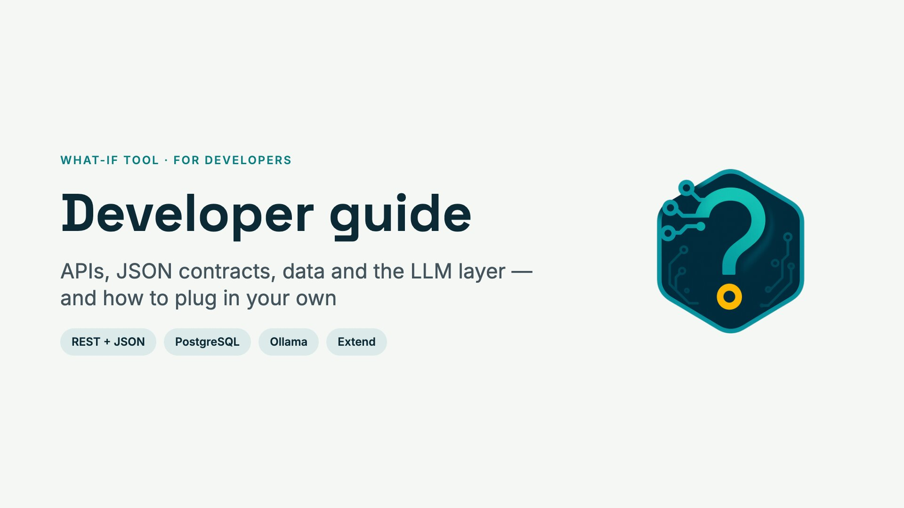

**Speaker notes.** This is the developer guide to the What-If Tool. It is for people who want to feed the tool from their own systems, read its results, or extend it with new use cases and other language models. We will cover the architecture, the REST API, the JSON going in and out, the database, the LLM layer, how to swap in your own model, and practical recipes for extending and integrating.

## 2. Two flows: data in, people out

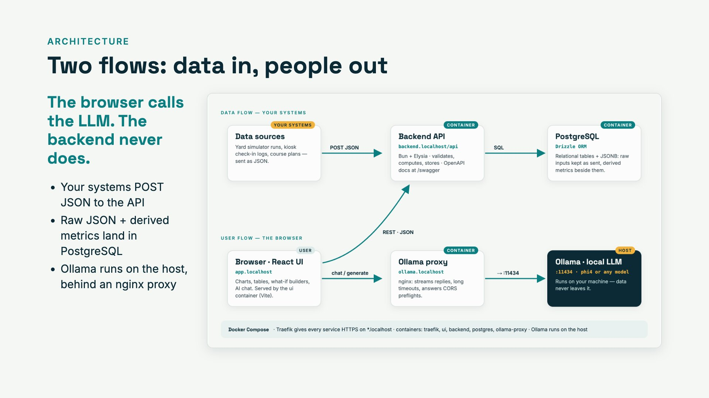

**Speaker notes.** The system has two flows. The data flow: your systems — a yard simulator, a kiosk, a course planning system — post JSON to the backend API, built on Bun and Elysia. The backend validates it, computes what it can once, and stores both the raw JSON and the derived metrics in PostgreSQL. The user flow: the browser runs the React UI. It reads results from the backend over REST, and it talks to the language model itself, through an nginx proxy, to Ollama running on the host machine. The backend has no LLM code at all. Everything runs in Docker Compose behind Traefik, which gives each service HTTPS on a .localhost name; only Ollama runs outside Docker.

## 3. One API, three domains

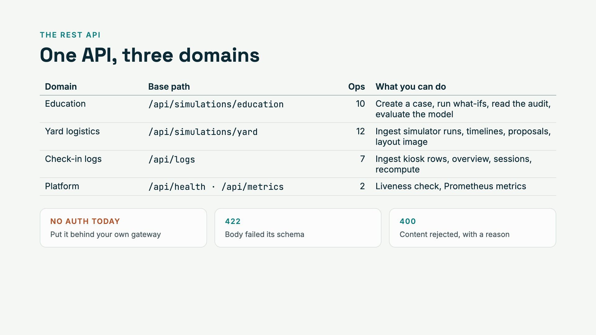

**Speaker notes.** Everything sits under one REST API at backend.localhost/api, grouped into three domains. Education lives under /api/simulations/education with ten operations: create a case, run user what-ifs, read the full audit trail, and evaluate the stress model directly. Yard logistics has twelve: ingest simulator runs, add runs later, occupancy timelines, improvement proposals and the yard image. Check-in logs has seven: ingest kiosk rows, read the overview and sessions, and recompute analytics. Health and metrics complete the platform. There is no authentication today, so put the API behind your own gateway. Errors follow two rules: 422 means the body failed its schema; 400 means the content was understood but rejected, with a message telling you why.

## 4. Every endpoint, documented at /swagger

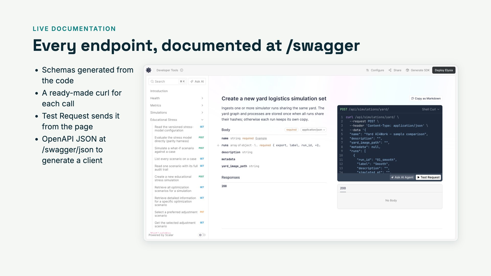

**Speaker notes.** You never have to guess the contract. The backend serves interactive OpenAPI documentation at /swagger. The schemas come straight from the route definitions in the code, so they match what the server actually accepts. Each operation has a ready-made curl example, and Test Request sends the call right from the page. The raw OpenAPI document is at /swagger/json, which you can feed to any client generator.

## 5. Send simulator runs exactly as they are

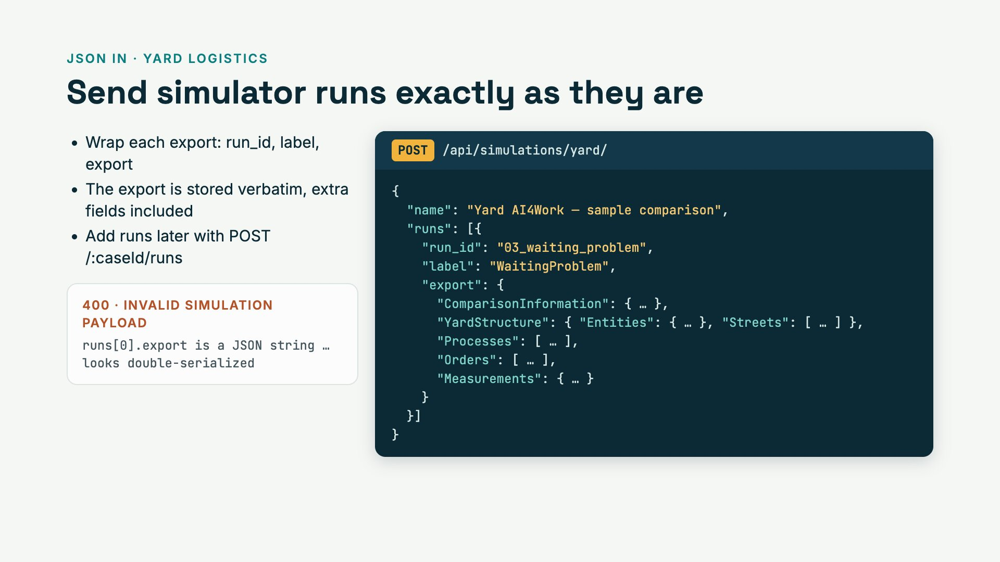

**Speaker notes.** To bring yard data in, you post the simulator's export exactly as the simulator wrote it. Our wrapper only adds a case name and, per run, a run id and a label; the export itself goes in verbatim and is stored as JSON, extra fields included, so a simulator that adds fields will not break ingest. Later runs can be added to the same case with POST to the case's runs endpoint, which is also the natural target for a simulator webhook. Before storing, the backend checks just the four parts it actually reads — ComparisonInformation, the yard entities, the orders and the measurements — and rejects anything else with a 400 that says exactly what is wrong. The most common mistake, a double-serialized export string, gets its own message.

## 6. A what-if is a list of typed adjustments

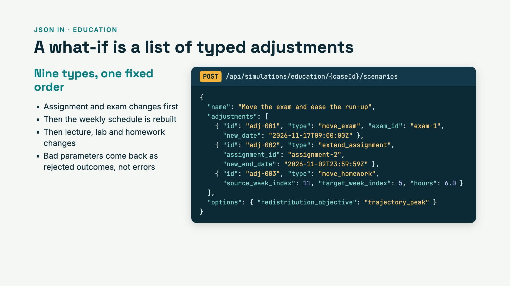

**Speaker notes.** For education, the case itself is created once from a course definition: dates, sessions, assignments with hours, the exam, and optionally observed stress. A what-if is then posted to the case's scenarios endpoint as a named list of typed adjustments. There are nine types: four week-level ones — cancel a lecture or a lab, reduce or move homework — and five domain ones that move, update or extend an assignment, or move or cancel an exam. The engine always applies them in the same order: domain changes first, then it rebuilds the weekly schedule, then the week-level changes, so a rebuild can never wipe out a week-level edit. Week indexes are zero-based. And a bad parameter does not fail the request: it comes back as a rejected outcome with a code.

## 7. Every result carries its own audit trail

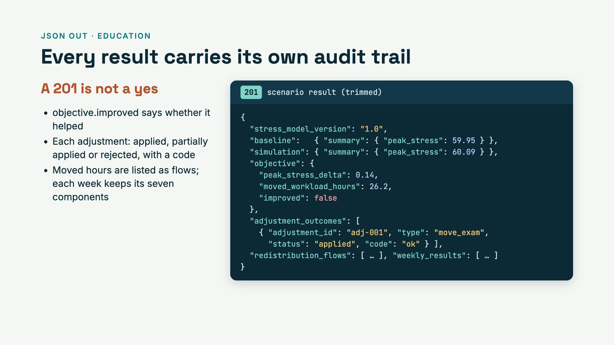

**Speaker notes.** What comes back is a complete, auditable result. Here is the scenario we just posted. All four adjustments were applied — but the peak went from 59.95 to 60.09, so objective.improved is false. That is the important habit for integrators: a 201 means the scenario ran, not that it helped. Check objective.improved, and check each adjustment outcome: applied, partially applied or rejected, each with a machine-readable code and a message. Every redistributed hour is listed as a flow, and weekly results carry all seven stress components for every week, so you can show your users exactly why a number changed. The stress-model version ships with every response.

## 8. Raw JSON kept, metrics computed once

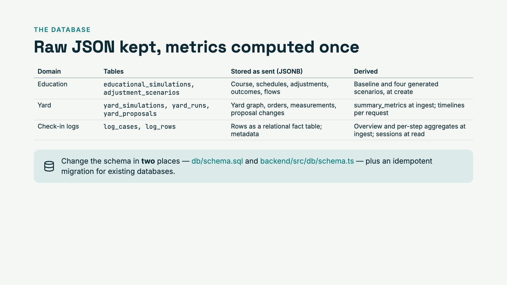

**Speaker notes.** The database is PostgreSQL, accessed through Drizzle. The design rule is simple: keep what partners send exactly as they sent it, and compute derived numbers once. Partner-owned structures — a yard graph, orders and measurements, a course definition, every adjustment and its outcome — live in JSONB columns, so new partner fields never need a migration. Next to them sit the derived results: yard summary metrics and log aggregates are computed at ingest, the education baseline and its four generated scenarios at creation. Things that are cheap to compute, like occupancy timelines and log sessions, are rebuilt on each request instead of stored. Yard runs over the same layout share one copy of the yard graph; stock levels are ignored when comparing. When you change the schema, edit both the SQL file, which bootstraps a fresh database, and the Drizzle file the backend uses at runtime, and ship a small idempotent migration for databases that already exist.

## 9. The AI runs from the browser, through one file

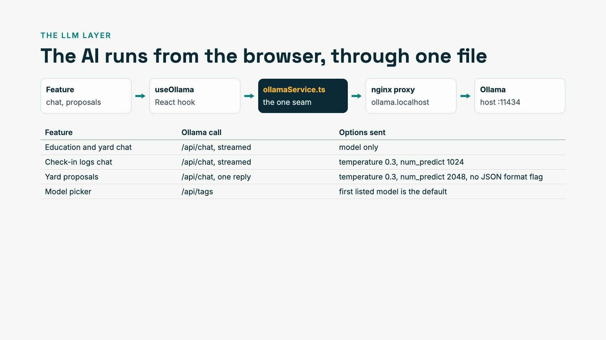

**Speaker notes.** All AI calls are made by the browser. A feature component — a chat or the proposal generator — calls the useOllama hook, which calls ollamaService.ts. That one file is the only place that knows the Ollama API. Requests go to the nginx proxy at ollama.localhost, which streams replies, allows long generations of up to twenty minutes, and forwards to Ollama on the host. The chats stream from the chat endpoint; the logs chat lowers the temperature and caps the reply length; proposal generation asks for one reply, capped at 2048 tokens, and deliberately does not use Ollama’s JSON mode, because reasoning models can hang on it — a tolerant parser and server-side validation handle the output instead. Each feature rebuilds its prompt from the data on the page for every message, and nothing about the conversation is stored on the server.

## 10. Three ways to swap the model

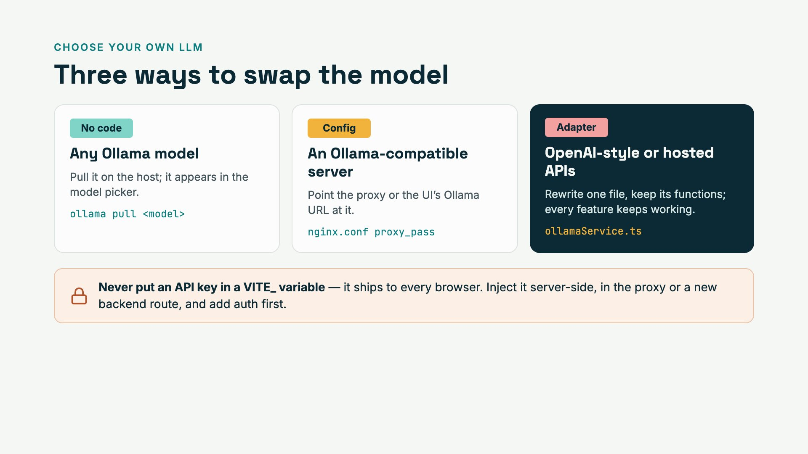

**Speaker notes.** You can change the model at three levels. First, any Ollama model: pull it on the host and it shows up in the model picker — no code. For proposal generation, prefer models that answer directly over reasoning models. Second, any server that speaks the native Ollama API: change proxy_pass in the nginx config, or point the UI’s Ollama URL at it — configuration only. Third, OpenAI-compatible servers such as vLLM, LM Studio or llama.cpp, or hosted APIs: these need an adapter, and there is exactly one place to write it — ollamaService.ts. Keep its exported functions, for listing models and for streaming and non-streaming chat, and translate to the provider’s format; nothing above that file has to change. One rule matters for hosted models: never put an API key in a VITE variable, because Vite compiles it into the JavaScript every visitor downloads. Inject the key server-side instead, in the proxy or in a new backend route — neither exists today — and add authentication first, because today neither the proxy nor the API has any.

## 11. Three recipes you will reach for

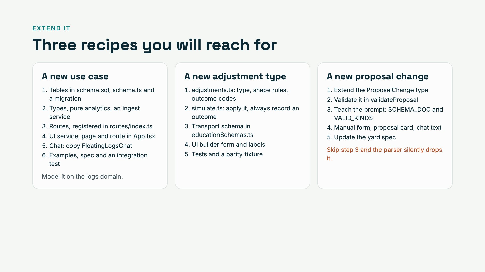

**Speaker notes.** Three extensions come up most often. A whole new use case is a vertical slice; the check-in logs domain is the cleanest one to copy. Add the tables to both schema files plus a migration, write the types, a pure analytics service you can unit-test and an ingest service that writes in a transaction, then the routes, registered in routes/index.ts with static paths before parameterised ones. On the UI side add a service, a page and its route, and copy the logs chat for the AI — it only needs a system prompt and a context builder. Finish with example bodies, an OpenAPI spec and an integration test. A new education adjustment type lives mainly in two files: adjustments.ts for the type, its shape rules and outcome codes, and simulate.ts to apply it — always recording an outcome — plus the transport schema, the builder form and a parity fixture. A new yard proposal change kind needs the type, a validation case, and — easy to miss — the prompt’s schema description and the parser’s list of valid kinds; otherwise the model’s output is silently dropped.

## 12. Hook it into your system

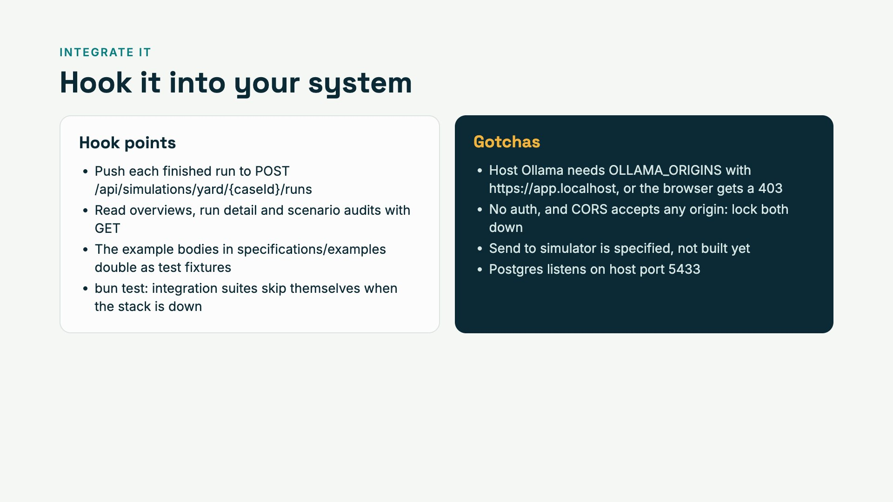

**Speaker notes.** To plug the tool into your own system, the natural hook is the add-run endpoint: when your simulator finishes a run, post it to the case’s runs endpoint and it appears beside the others, validated the same way. Your system reads results back with plain GETs — case overviews, run detail, scenario audit trails. The example request bodies in specifications/examples are the same files the integration tests post, so they are known to work; and bun test runs everything, with the integration suites skipping themselves if the stack is not running. A few gotchas. The host’s Ollama must be started with OLLAMA_ORIGINS including https://app.localhost — without it the browser’s AI calls are refused with a 403. There is no authentication and CORS accepts any origin, so put the API behind your gateway and restrict CORS before exposing it. Sending a proposal back to the simulator is specified in the yard API spec but not implemented yet. And Postgres is published on host port 5433, not 5432.

## 13. Five things to remember

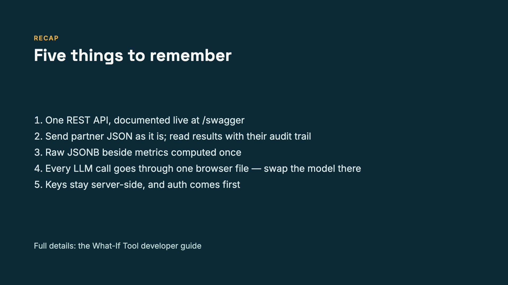

**Speaker notes.** To recap. One REST API, documented live at /swagger. Partners send their JSON as it is, and every result comes back with its own audit trail. The database keeps raw JSONB beside metrics computed once. Every LLM call goes through a single browser file, ollamaService.ts, which is where you swap in another model or provider. And if you move to a hosted model, keep the key on the server and add authentication first. The developer guide has every endpoint, contract and recipe in detail.

