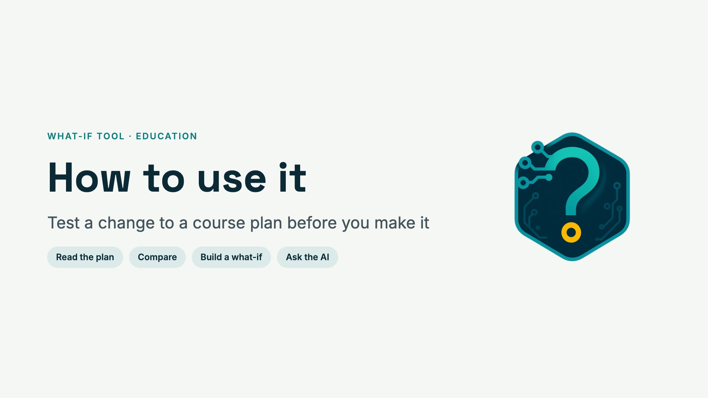
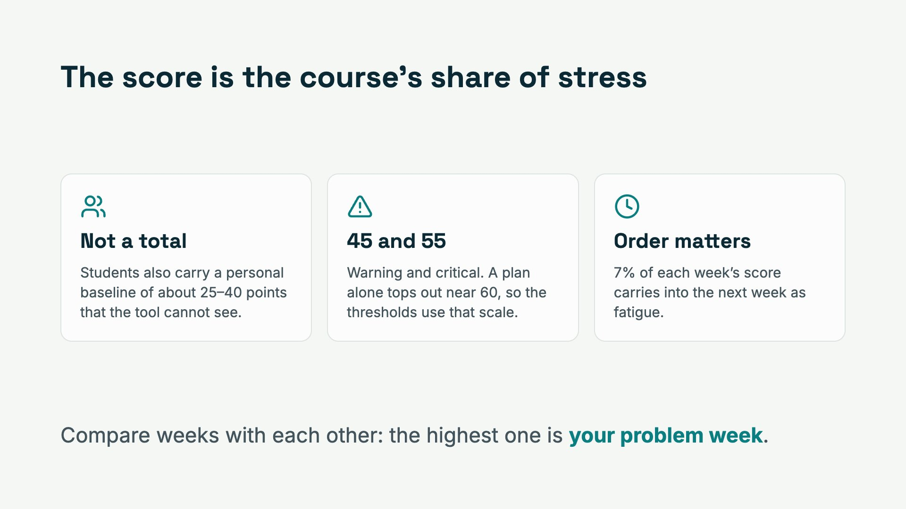
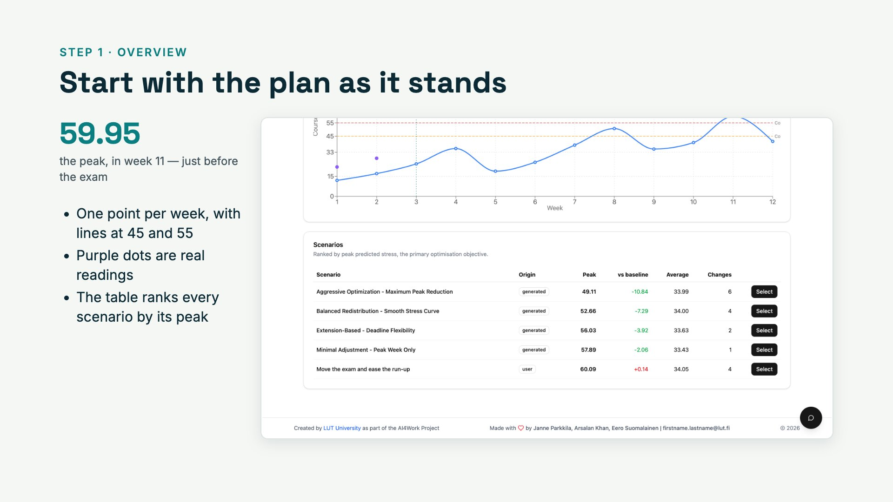
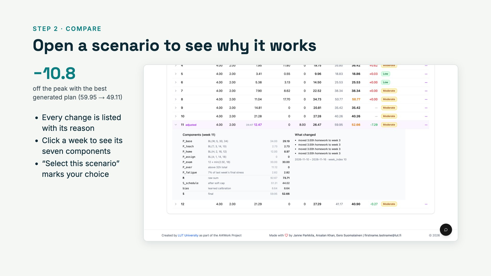
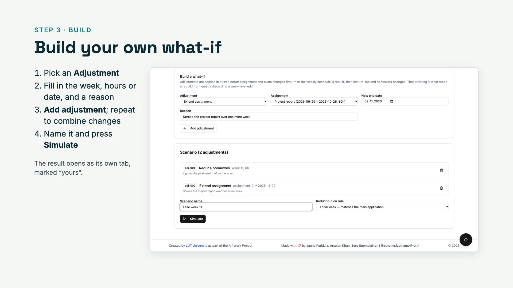
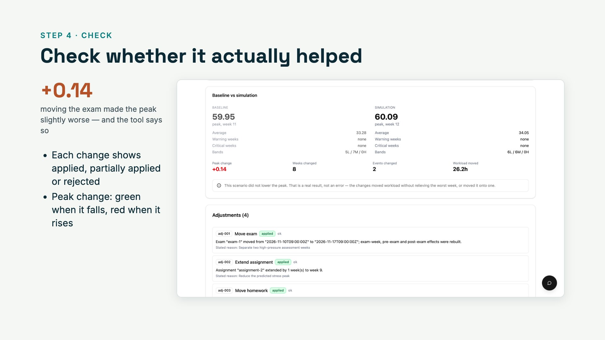
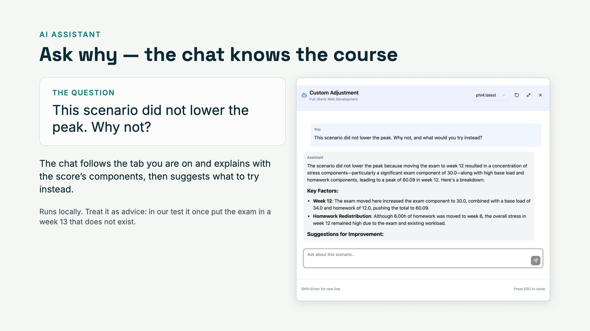
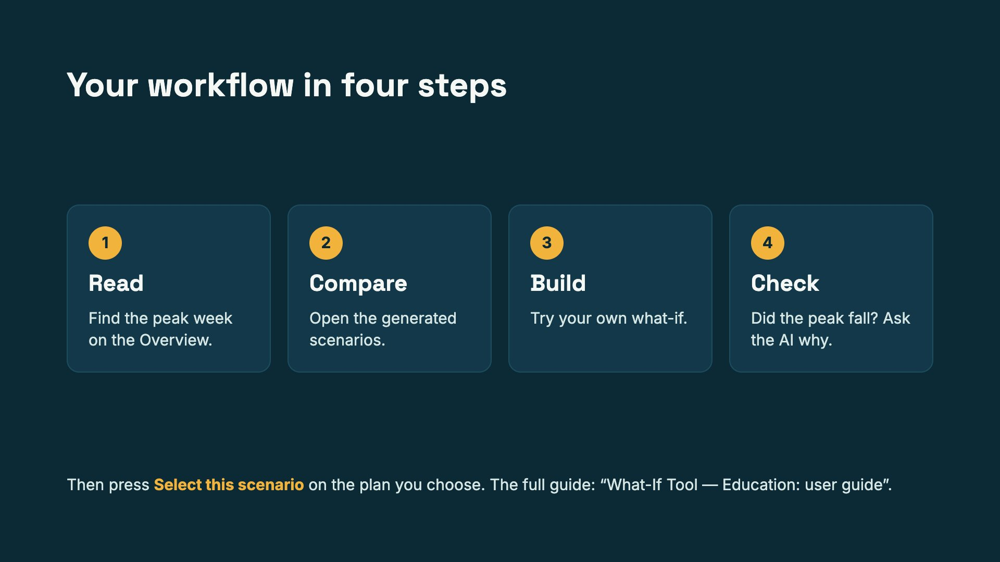

# Education: how to use it (slides)

What-If Tool — Education: how to use it — 8 slides. Also available as [PDF](education_slides.pdf) and [PowerPoint](education_slides.pptx).

## 1. How to use it

**Speaker notes.** This is a short guide to the education part of the What-If Tool. It is for teachers and course planners. You will see how to read a course plan’s predicted stress, compare the alternatives the tool generates, build your own what-if, check honestly whether it helped, and ask the AI assistant for an explanation.

## 2. The score is the course’s share of stress

**Speaker notes.** Before using the tool, one thing about its number. The weekly score, from 0 to 90, is what the course plan adds to students’ stress — not anyone’s total stress. Everybody also carries a personal baseline of roughly 25 to 40 points the tool cannot see. A course plan on its own tops out at about 60, so the warning and critical lines sit at 45 and 55. And because 7% of each week’s score carries over into the next week as fatigue, the order of weeks matters. Above all, compare weeks with each other: the highest one is the week to work on.

## 3. Start with the plan as it stands

**Speaker notes.** Open the course’s page and you land on the Overview. The course card at the top lists the weeks, assignments and the exam. The chart shows the plan as it stands, one point per week, with dashed lines at the warning and critical levels and purple dots where real stress readings exist. In the demo course, the peak is 59.95 in week 11, just before the final exam. Below the chart, the Scenarios table ranks every alternative by its peak, and the Select button marks the plan you choose.

## 4. Open a scenario to see why it works

**Speaker notes.** The tool generates four alternative plans on its own. Each tab shows the scenario’s line against the dashed baseline, the before-and-after numbers, and every change it makes, with a reason. The best one here, Aggressive Optimization, cuts the peak from 59.95 to 49.11. At the bottom, the weekly breakdown marks the weeks that changed. Click any week to open the seven components behind its score — base load, teaching, homework, assignments, exam, overload and fatigue — and the list of what changed. When one suits you, press Select this scenario.

## 5. Build your own what-if

**Speaker notes.** To try your own idea, open the New what-if tab. Pick the kind of change — there are nine, from cancelling a lecture to moving an exam. Fill in the week, the hours or the new date, and a short reason. Press Add adjustment, and repeat to combine several changes into one scenario. Give it a name and press Simulate. Here we take six hours of homework out of week 11 and give the project report one more week. The result opens as its own tab, marked yours, and joins the ranking.

## 6. Check whether it actually helped

**Speaker notes.** A scenario that ran is not the same as a scenario that helped. Check two things. First, the Adjustments list: every change says whether it was applied, partially applied or rejected, and why. Second, the peak change: green when the peak fell, red when it rose. Here someone moved the exam a week later. All four changes were applied, yet the peak rose by 0.14, because the exam landed on top of the heaviest homework week. The tool says so plainly instead of hiding it. By contrast, Ease week 11 lowered the peak to 56.05.

## 7. Ask why — the chat knows the course

**Speaker notes.** Whenever a number puzzles you, open the round chat button in the corner. The assistant already knows the course, every scenario and the breakdown behind each week, and it follows the tab you are on. Here we asked why moving the exam did not help. It points to the actual components — the exam pressure now stacked on top of base load and homework in week 12 — and suggests alternatives. It runs on a local model, so the course data stays on your machine. Treat it as advice: in another answer it placed the exam in week 13, which this twelve-week course does not have. Always check facts against the page.

## 8. Your workflow in four steps

**Speaker notes.** To sum up, four steps. Read the plan on the Overview and find the peak week. Compare the scenarios the tool generated. Build your own what-if for the idea you have in mind. Then check whether the peak actually fell, and ask the AI assistant to explain anything that surprises you. When you have decided, press Select this scenario. The written user guide covers every step in more detail.

