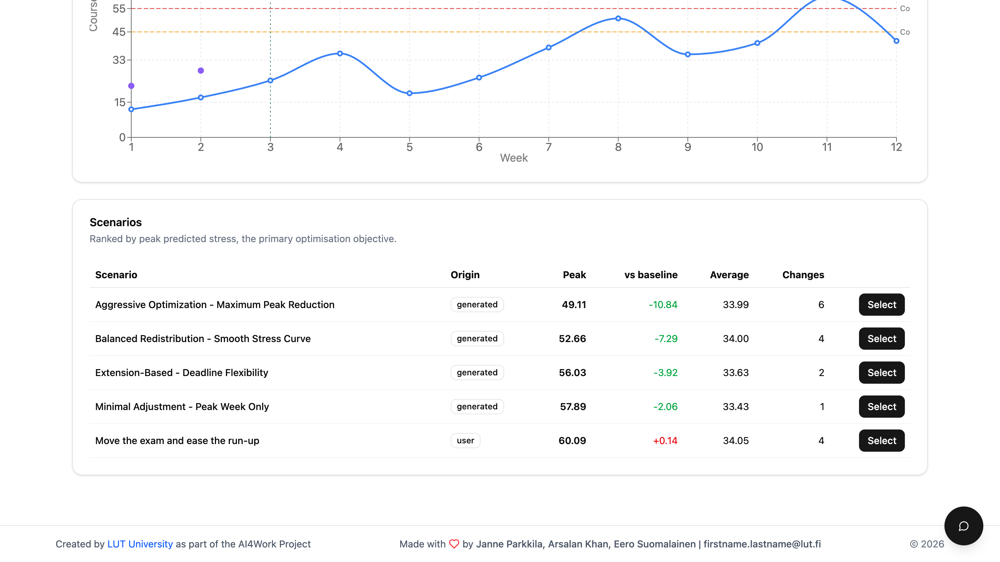
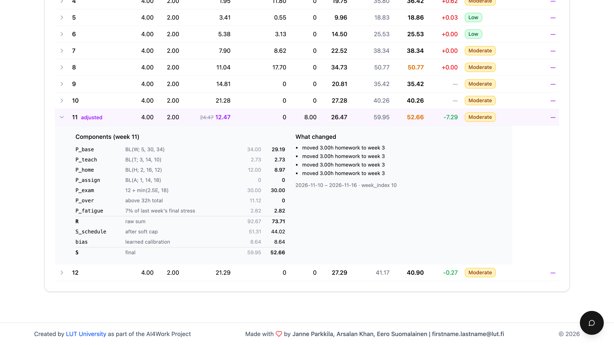
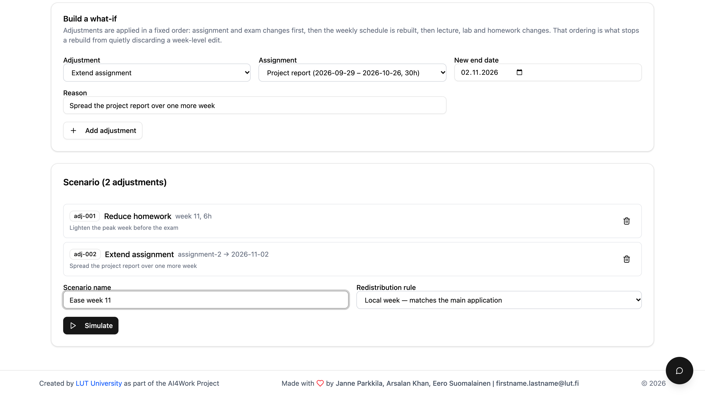
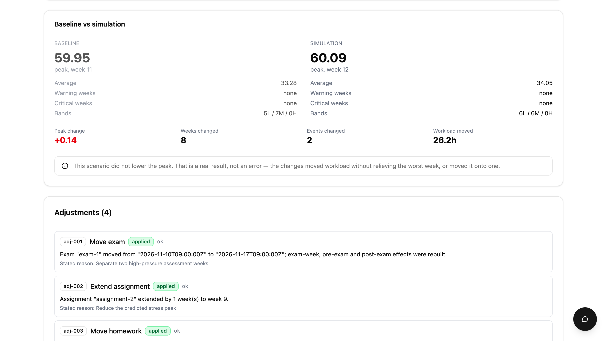
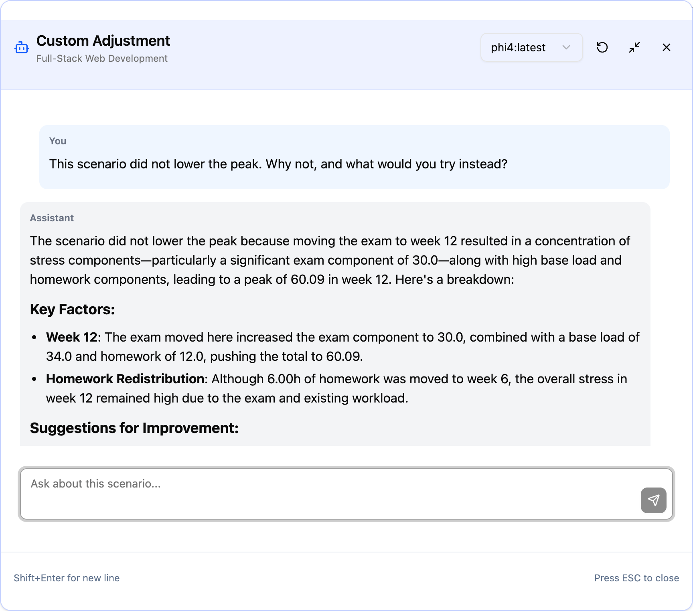

# Education: course stress what-ifs

Nov 12, 2026 · Janne Parkkila

## What it does

The education view predicts how much stress a course plan adds to students each week, so you can test a change — moving an exam, extending a deadline, cancelling a lecture — before you commit to it.

For every week it looks at five kinds of load: lectures, labs, homework, active assignments and exams. It turns them into seven components and adds them up into one weekly score between 0 and 90. A small share of each week’s score (7%) carries over into the next week as fatigue, so the order of the weeks matters.

**How to read the score:**

- It is the course’s *contribution* to stress, not a student’s total stress. Everyone also carries a personal baseline of roughly 25–40 points that the tool cannot see.

- A course plan on its own tops out at about 60, so the tool uses thresholds calibrated to that scale: **45 = warning**, **55 = critical**.

- Compare weeks with each other, not only with the thresholds. A week at 55 in a semester that otherwise sits around 20 is your problem week.

The tool models the plan, not individual people. It is not a measurement of any one student and not a clinical instrument.

## Open a course

Every course has its own page; open the link you were given for it (it ends in `/education/` followed by the course’s id). The page reads top to bottom:

1.  **Header** — the course plan’s name, when it was created, and a `model 1.0` tag showing which stress model produced the numbers.

2.  **Course card** — course ID, semester dates, the current week, difficulty, number of students, and every assignment and exam with its dates and hours. In the demo course CS-220 that is 12 weeks, 60 students, two assignments and one final exam.

3.  **Tabs** — *Overview*, one tab per generated scenario, one per scenario you built (marked *yours*), and *New what-if*.

The **Overview** tab opens first. Its chart, *Baseline trajectory*, shows the course as planned: one point per week, a dashed *Now* line at the current week, and the warning (45) and critical (55) thresholds as dashed horizontal lines. Purple dots are observed stress readings, where you have them. In the demo the plan peaks at **59.95 in week 11**, just before the exam, with an average of 33.28.

Below the chart, the **Scenarios** table ranks every alternative by its peak. Each row shows whether the tool generated it or a person built it, its peak, the change against the baseline, the average, how many changes it makes, and a **Select** button to mark it as your chosen plan.

## Compare the generated scenarios

The tool generates alternative plans for you, each aimed at lowering the peak week. In the demo course the best one cuts the peak from 59.95 to 49.11:

| Generated scenario | Peak | vs baseline | Average | Changes |
|----|----|----|----|----|
| Aggressive Optimization — Maximum Peak Reduction | 49.11 | −10.84 | 33.99 | 6 |
| Balanced Redistribution — Smooth Stress Curve | 52.66 | −7.29 | 34.00 | 4 |
| Extension-Based — Deadline Flexibility | 56.03 | −3.92 | 33.63 | 2 |
| Minimal Adjustment — Peak Week Only | 57.89 | −2.06 | 33.43 | 1 |

Click a scenario’s tab to see it in full:

- **Chart** — the scenario (solid line) against the baseline (dashed line), week by week.

- **Baseline vs simulation** — peak and average before and after, warning and critical weeks, plus how many weeks changed and how many hours of work were moved.

- **Adjustments** — every change the scenario makes, with its status and the reason for it. *Balanced Redistribution*, for example, moves 3 hours of homework from week 11 to week 3, four times.

- **Weekly breakdown** — a table of each week’s hours and score, with adjusted weeks marked. **Click any week** to open the seven components behind its score (base load, teaching density, homework, assignment, exam, overload and fatigue carry-over) and a list of what changed in that week.

When a scenario suits you, press **Select this scenario** at the top of its tab. A star appears on its tab and the choice is saved for the course.

## Build your own what-if

The *New what-if* tab lets you combine your own changes into a scenario and simulate it in one click.

1.  Open the **New what-if** tab.

2.  In **Adjustment**, pick the kind of change — for example *Reduce homework* or *Extend assignment*. The fields below change to match it (a week, a number of hours, an assignment, an exam, or a new date).

3.  Fill in those fields and a short **Reason**. The reason is kept with the result, so others can see why the change was tried.

4.  Press **Add adjustment**. It joins the list under *Scenario*; the trash icon removes it again. Repeat for every change you want to combine.

5.  Give the scenario a **Scenario name**, for example *Ease week 11*.

6.  Leave **Redistribution rule** on *Local week* unless you know you want *Whole trajectory*. It only matters when you cancel a lecture or lab: it decides where those hours move to.

7.  Press **Simulate**. A few seconds later the scenario appears as its own tab, marked *yours*, and joins the ranking on the Overview.

The order you add changes in does not matter. The tool always applies assignment and exam changes first, rebuilds the weekly schedule, and only then applies lecture, lab and homework changes — so a rebuild can never wipe out a week-level edit.

In the demo, *Ease week 11* combines two changes: take 6 hours of homework out of week 11 and extend the project report by a week. It lowers the peak from 59.95 to 56.05.

## Read the result honestly

A scenario that ran is not a scenario that helped: check two things on its tab before you choose it.

**1. Did every change go through?** Each adjustment in the *Adjustments* list carries a status:

| Status | Meaning |
|----|----|
| applied | the change was made in full |
| partially applied | only part of it could be made, for example fewer hours moved than you asked for |
| rejected | nothing was changed; the code beside it says why |

Common reasons for a rejection:

| Code | What it means |
|----|----|
| week_in_past | the week has already happened (the course card shows the current week) |
| date_outside_semester | the new date falls outside the course dates |
| extension_not_later | the new deadline is not later than the current one |
| extension_limit_reached | the assignment has used up its allowed extensions |
| insufficient_homework | the source week had less homework than you asked to move |
| assignment_has_no_hours | the assignment carries no hours, so moving it changes nothing |

**2. Did the peak go down?** The *Baseline vs simulation* card shows the **Peak change** in green when it fell and in red when it rose. When a scenario does not lower the peak, the tab says so plainly instead of hiding it.

The demo shows why this matters. *Move the exam and ease the run-up* applies all four of its changes, yet the peak rises from 59.95 to **60.09 (+0.14)**: the exam moves into week 12, on top of the semester’s heaviest homework. *Ease week 11*, which simply takes load out of the peak week, lowers it to 56.05 (−3.90).

Two more cards appear when they apply: **Redistribution flows** shows where cancelled lecture or lab hours went and what each placement cost, and **Deadline extensions** records every extension with its reason and timestamp.

## Ask the AI assistant

The round chat button in the bottom-right corner opens an AI assistant that already knows the course, its scenarios and the score breakdown behind every week. It runs on a local language model (phi4, served by Ollama on the same machine), so the course data is not sent to an outside service.

The chat follows the tab you are on. On the *Overview* it can talk about the whole course and compare all scenarios. On a scenario’s tab it focuses on that scenario and opens by summarising it — for example, that it moves the peak from 59.9 in week 11 to 60.1 in week 12. Use the expand button in the chat header for a larger window, the circular-arrow button to start over, and the model picker if more than one model is installed.

Questions that work well:

- *Which weeks are the most stressful, and what drives the peak in week 11?*

- *This scenario did not lower the peak. Why not, and what would you try instead?*

- *Which scenario is the best trade-off between peak and disruption?*

- *What do the components in week 8 mean?*

The assistant is told to name the components that drive a week rather than repeat its score, and to say plainly when a change did not help. Treat its answers as advice, not as results:

- **It can be wrong.** In our test it explained the week-11 peak correctly but also said the exam was in week 13 — a week this 12-week course does not have. Check any fact against the course card and the weekly breakdown.

- **It does not change anything.** Only the what-if builder creates scenarios; the assistant can suggest what to try.

- **Its numbers come from the tool.** When it quotes a score, it is reading the same model output you see on the page.

## Quick reference

Nine kinds of change are available in the what-if builder:

| Adjustment | What it does |
|----|----|
| Cancel lecture | removes that week’s lecture hours and moves them to later weeks, at most 3 hours at a time, wherever they cost least |
| Cancel lab | the same for lab hours |
| Reduce homework | takes hours out of a week; they are gone, not moved |
| Move homework | moves hours from one week to another, up to what the first week actually has |
| Move assignment | gives an assignment new start and end dates; its hours spread over the new span |
| Update assignment | changes an assignment’s dates and/or estimated hours |
| Extend assignment | pushes a deadline later, recorded with a reason and a timestamp |
| Move exam | moves an exam, together with its effect on the weeks before and after |
| Cancel exam | removes an exam and everything it caused |

Key terms:

| Term | Meaning |
|----|----|
| Baseline | the course as planned, before any change |
| Scenario | a set of changes plus its simulated result |
| Peak | the highest weekly score in the semester — the number the generated scenarios try to lower |
| Component | one of the seven parts that add up to a week’s score |
| Fatigue carry-over | 7% of the previous week’s score, added to this week |
| Observed stress | real stress readings for past weeks, shown as purple dots and used to correct later predictions |
| Warning / critical | 45 / 55 on the course-model scale |
