# What-If Tool — 6-minute overview (slides)

What-If Tool — 6-minute overview — 11 slides. Also available as [PDF](overview_slides.pdf) and [PowerPoint](overview_slides.pptx).

## 1. What-If Tool

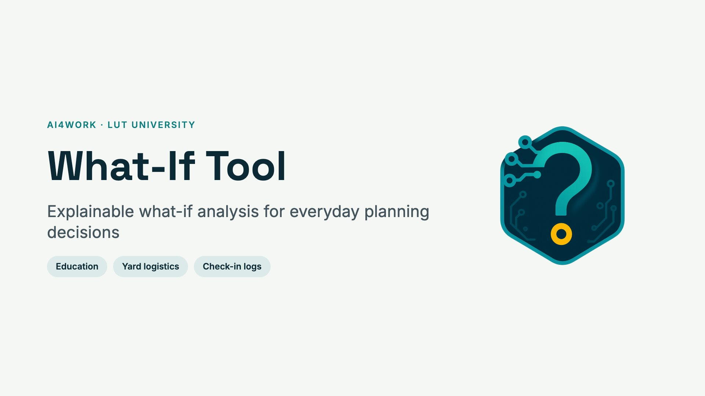

**Speaker notes.** Hi — this is the What-If Tool, built at LUT University in the AI4Work project. In the next six minutes I’ll show what it does in three real settings: course planning in education, truck-yard logistics, and check-in kiosk logs — and how its AI helps without taking decisions away from people.

## 2. Planners keep asking “what if?”

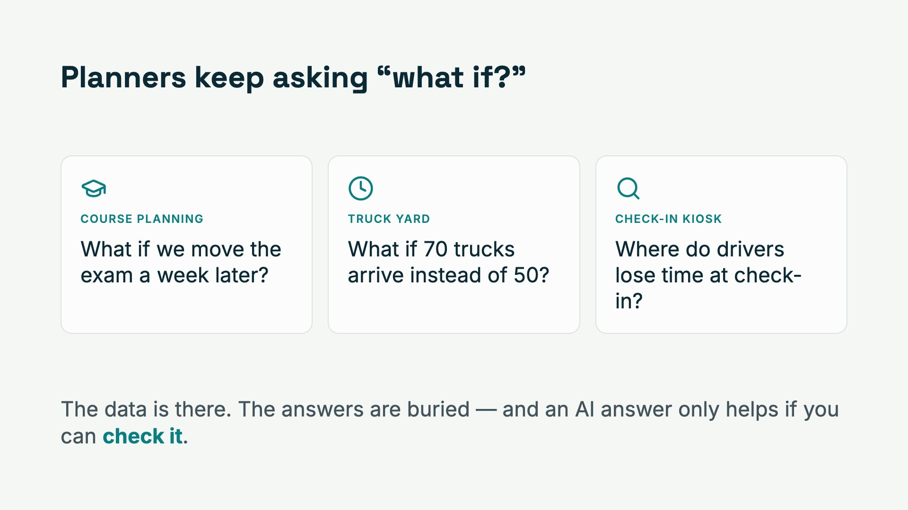

**Speaker notes.** Every planner lives with “what if” questions. A teacher wonders what happens if the exam moves a week. A yard manager wonders what happens when seventy trucks show up instead of fifty. A logistics team wants to know where drivers lose time at the check-in kiosk. The data to answer these exists — course plans, simulator runs, kiosk logs — but it is hard to read. And if an AI gives you an answer, it is only useful when you can see where that answer came from.

## 3. How it works

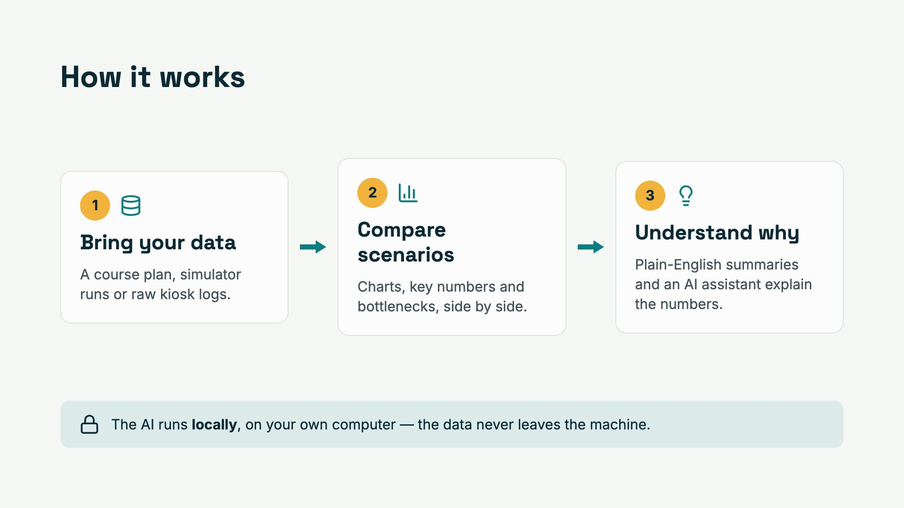

**Speaker notes.** The tool works the same way in every case. First, you bring your data: a course plan, the output of a yard simulator, or raw logs from a kiosk. Second, the tool turns it into scenarios you can compare — charts, key numbers, and where the bottlenecks are. Third, it explains why: every page has a plain-English summary and an AI assistant you can ask questions. One important detail: the AI model runs locally, on your own machine, so sensitive data does not go to an outside service.

## 4. Find the stress peak, then test fixes

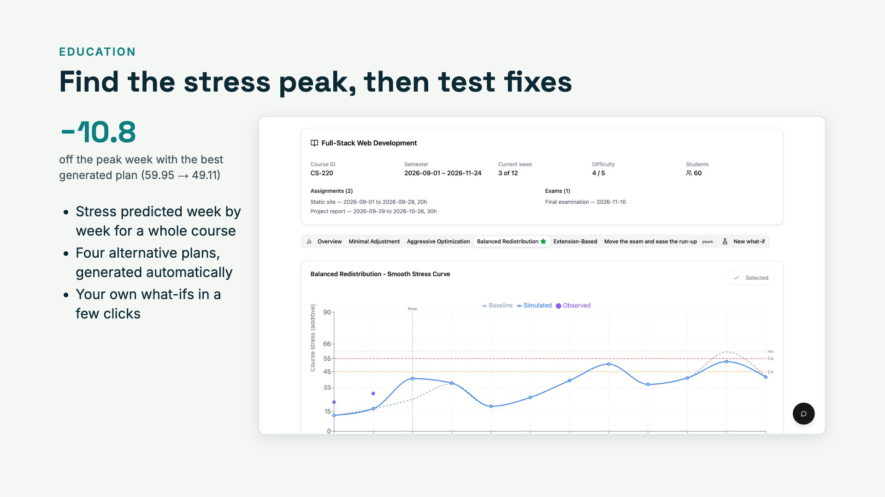

**Speaker notes.** First case: education. Here is an example course — twelve weeks, sixty students, two assignments and a final exam. The tool predicts how much stress the course adds each week. The dashed line is the plan as it stands: it peaks in week eleven, right before the exam. The tool automatically generates four alternative plans — moving homework, extending a deadline and so on. The best one takes almost eleven points off the peak week. You can also build your own what-if — that is the next slide.

## 5. Honest results — and the AI explains why

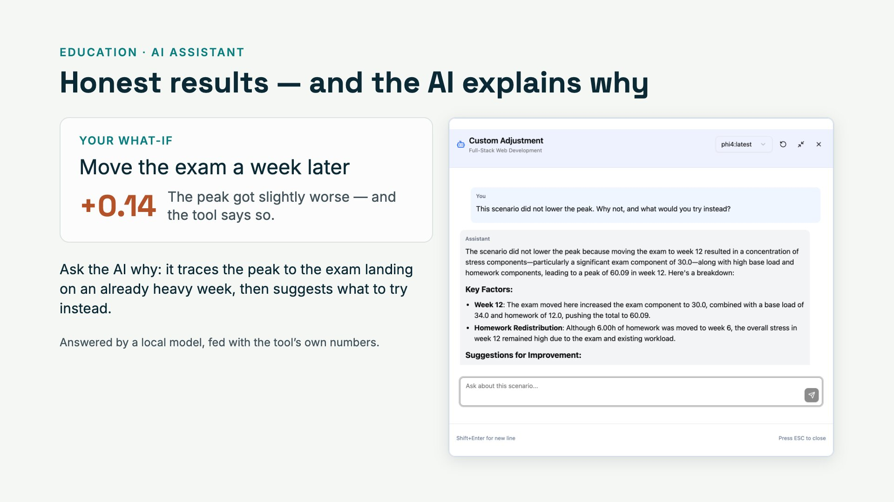

**Speaker notes.** Here someone tried their own idea: move the exam a week later. The tool simulated it — and the peak got slightly worse. That matters: the tool does not hide a change that didn’t help. Then we asked the AI assistant why. It pointed to the actual numbers: the exam now lands on top of the heaviest homework week. And it suggested what to try instead. The answer comes from a model running locally, which is given the tool’s own figures — so it explains the result rather than inventing one.

## 6. See where trucks get stuck

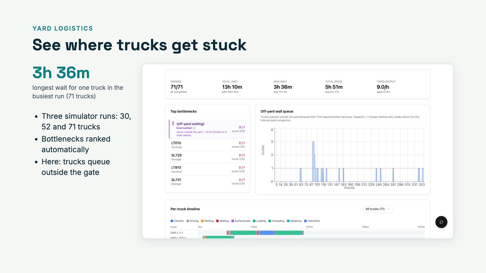

**Speaker notes.** Second case: a truck yard. Here the tool does not simulate — it reads the output of our partner’s yard simulator. We have three runs over the same yard, with 30, 52 and 71 trucks. With 52 trucks the longest wait is six minutes. With 71 it is three and a half hours. The tool ranks the bottlenecks automatically, and the top one is not inside the yard at all: trucks are queuing outside the gate, because there is only one check-in terminal. Below that, every truck’s day is shown on one timeline, with waiting time in red.

## 7. The AI drafts fixes — people decide

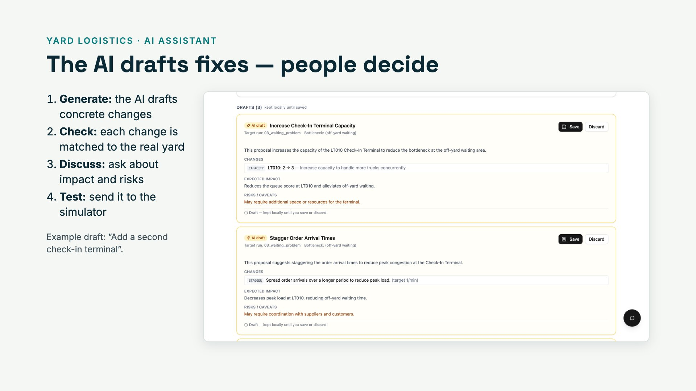

**Speaker notes.** This is where the AI helps the yard planner. One click, and the AI drafts improvement proposals for the worst run — here: add check-in capacity, spread out truck arrivals, or build a second check-in terminal. Each draft is structured: what to change, the expected impact, and the risks. The tool checks that every terminal, street or silo a draft names really exists in the yard — but the numbers still need a human eye, which is exactly why these are drafts. The planner saves the good ones and can discuss each with the AI — “how confident are you, what could go wrong?”. Once our partner’s simulator connection is live, a saved proposal goes straight back to the simulator to be tested. The AI suggests; people decide; the simulator verifies.

## 8. Raw kiosk events, told as a story

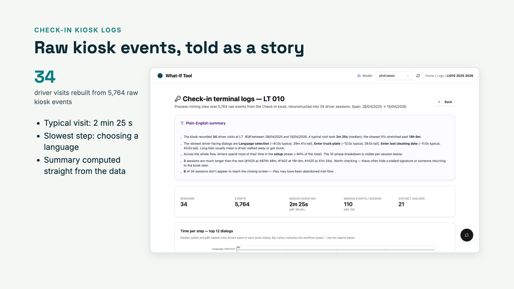

**Speaker notes.** Third case: the check-in kiosk at the yard gate. Its raw logs are thousands of German status messages — unreadable as they are. The tool rebuilds them into 34 driver visits and writes a plain-English summary at the top: a typical visit takes about two and a half minutes; the slowest step is choosing a language; a few visits ran for hours and are worth a look. This summary is computed straight from the data — no AI involved — so every sentence can be traced back to the numbers.

## 9. Ask why a step is slow

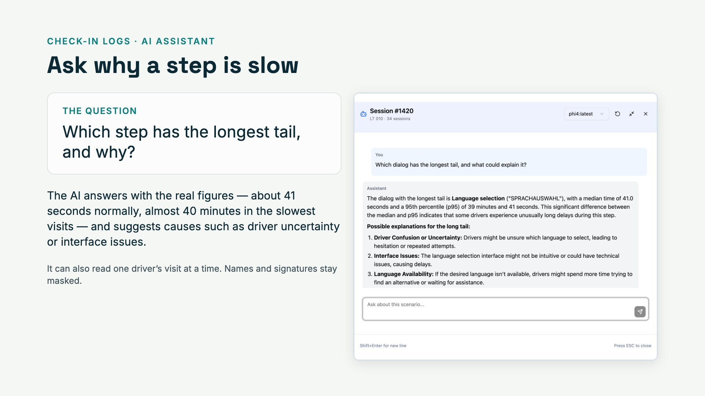

**Speaker notes.** And the AI assistant on top of the logs. We asked which step has the longest tail. It names the language-selection screen, quotes the actual numbers — about forty seconds normally, but close to forty minutes in the slowest visits — and offers plausible reasons, like drivers being unsure which language to pick. It can also look at one driver’s visit in detail. Personal data like names and signatures stays masked, and the assistant is told never to repeat it.

## 10. One AI assistant, three jobs

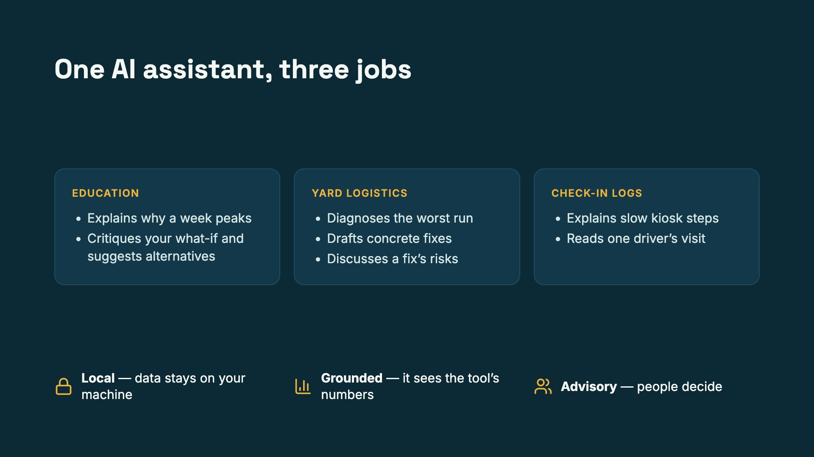

**Speaker notes.** Across the three cases it is the same assistant, doing different jobs. In education it explains why a week peaks and critiques your own what-ifs. In the yard it diagnoses the worst run, drafts concrete improvement proposals, and discusses a proposal’s risks. For the kiosk it explains slow steps and reads a single driver’s visit. Three principles hold everywhere: it runs locally, so data stays on your machine; it is grounded — it is given the tool’s own numbers, so it explains rather than guesses; and it is advisory — people make the decision, and the simulator checks the result.

## 11. Thank you — questions?

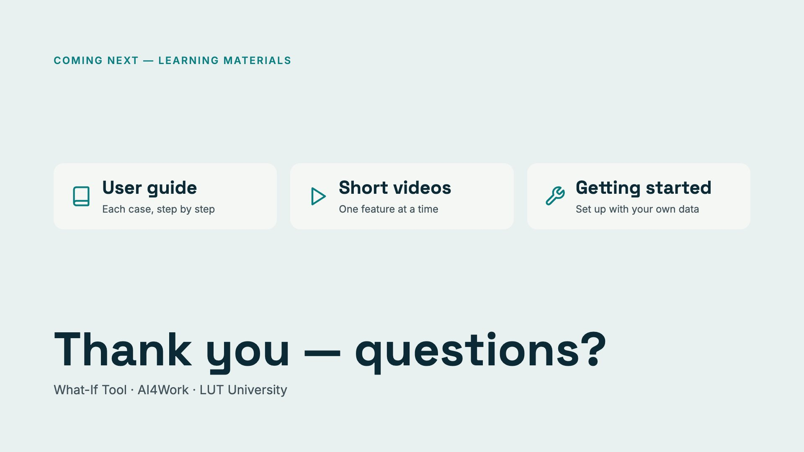

**Speaker notes.** To wrap up: the What-If Tool turns planning data into scenarios you can compare, explains them in plain language, and adds an AI assistant that stays local, grounded and advisory. Next we’ll publish learning materials — a user guide for each case, short videos of each feature, and a getting-started guide for setting the tool up with your own data. Thank you — happy to take questions.

