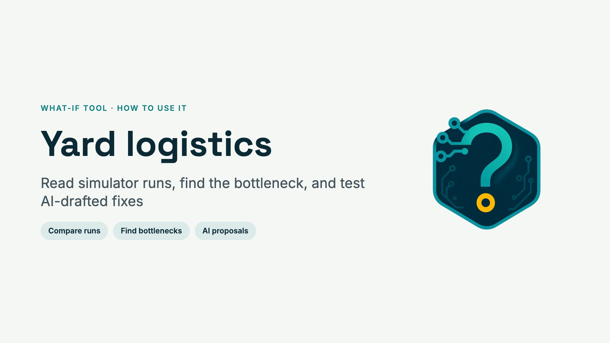
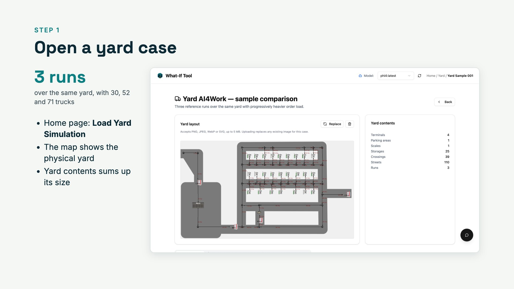
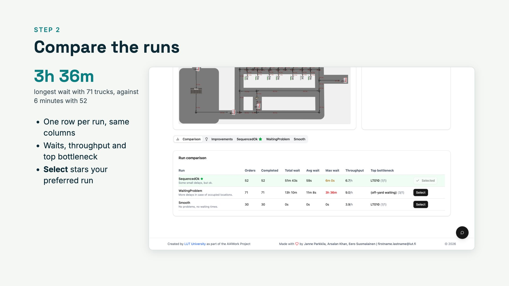
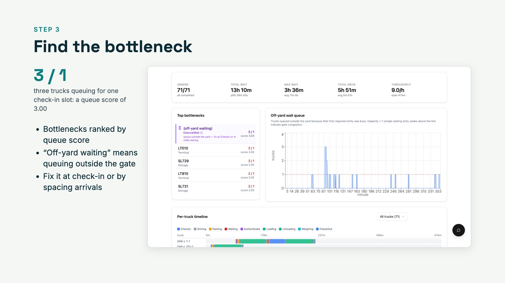
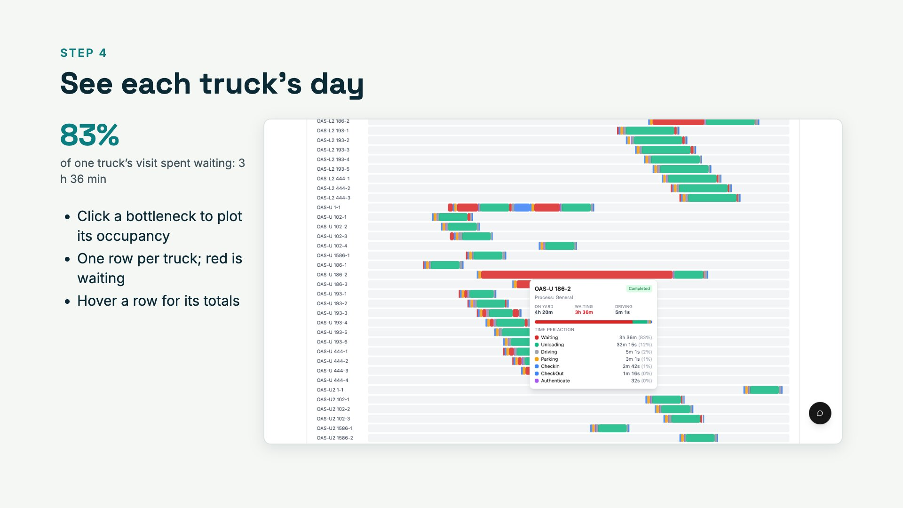
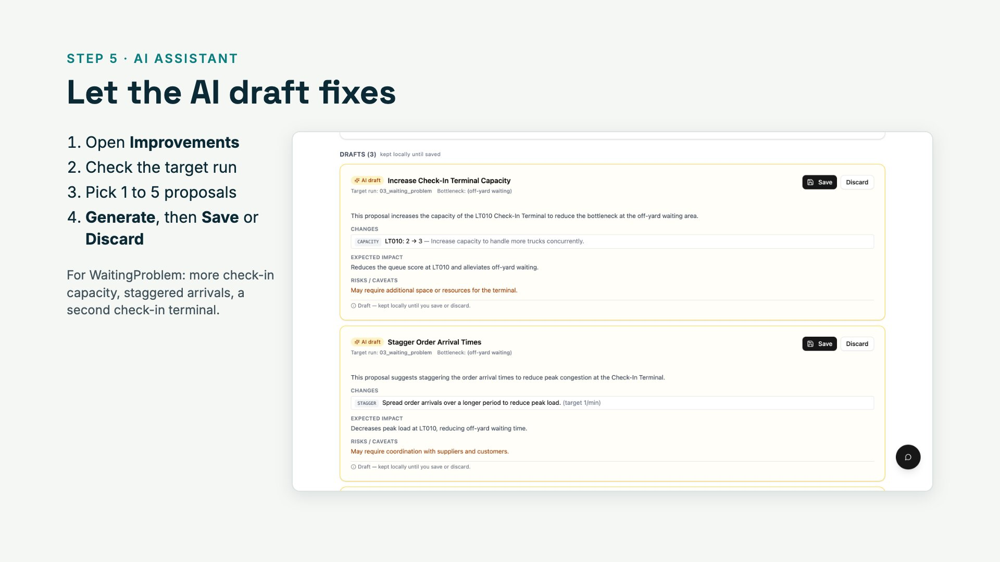
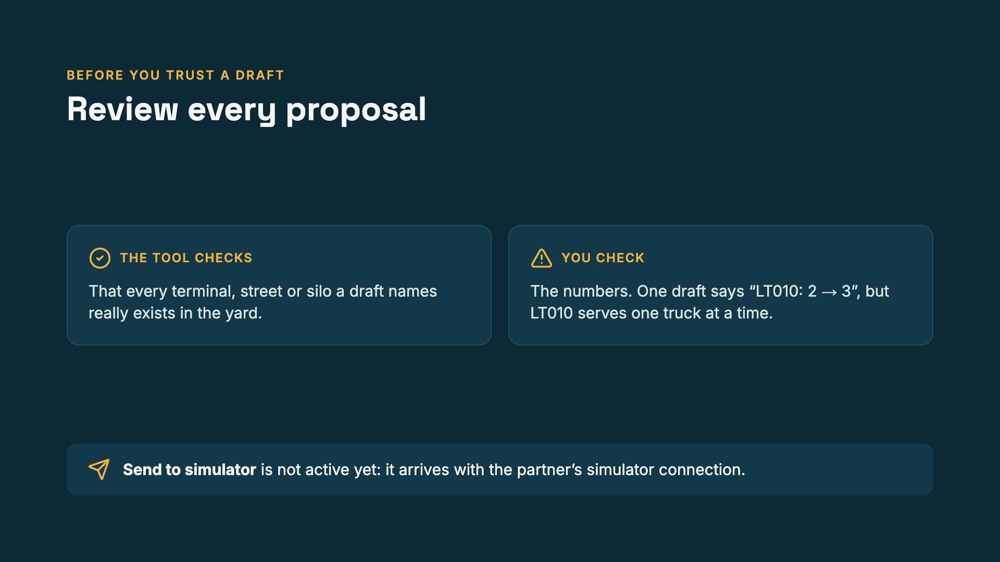
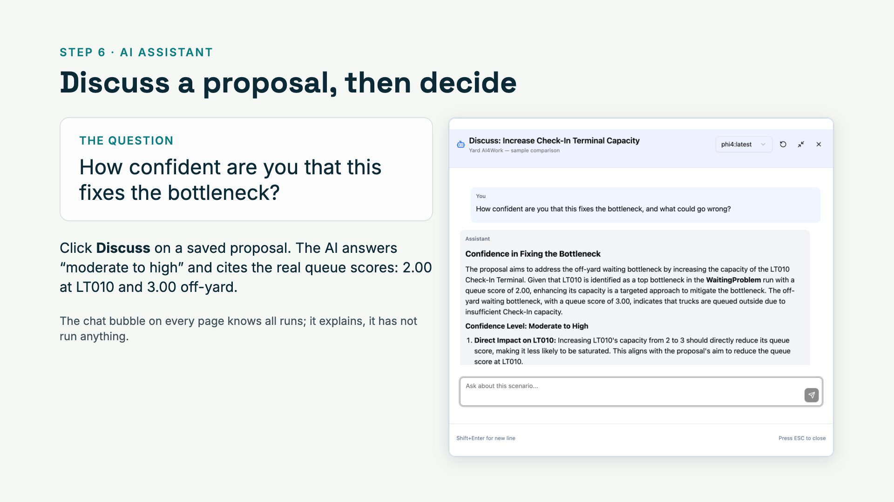
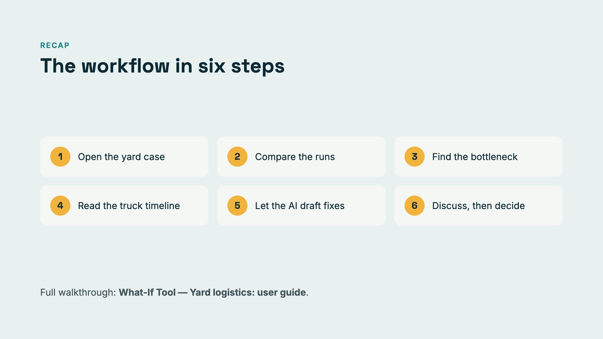

# Yard logistics: how to use it (slides)

What-If Tool — Yard logistics: how to use it — 9 slides. Also available as [PDF](yard_logistics_slides.pdf) and [PowerPoint](yard_logistics_slides.pptx).

## 1. Yard logistics

**Speaker notes.** This short walkthrough shows how to use the yard logistics part of the What-If Tool: open a yard case, compare its simulator runs, find where trucks lose time, and use the AI assistant to draft and discuss improvements. The example is the demo yard with three runs of 30, 52 and 71 trucks.

## 2. Open a yard case

**Speaker notes.** From the home page, click Load Yard Simulation. The case page opens with the map of the physical yard: the check-in terminal at the gate, the parking area, the barrier, the scale and twenty-five storage silos connected by streets. The Yard contents card on the right sums up its size. Below them are the runs — three simulator runs over this same yard, with thirty, fifty-two and seventy-one trucks. You can upload your own yard image with Replace.

## 3. Compare the runs

**Speaker notes.** The Comparison tab opens first. Each run is one row with the same columns: orders, completed orders, total, average and longest wait, throughput per hour, and the top bottleneck. The difference jumps out: with fifty-two trucks the longest wait is six minutes; with seventy-one it is three hours thirty-six. Click Select on a row to mark that run as your preferred outcome — it gets a star on its tab. Here SequencedOk is starred.

## 4. Find the bottleneck

**Speaker notes.** Open a run’s tab — here the worst one, WaitingProblem. The five key numbers sit on top. Below, Top bottlenecks ranks the places where more trucks were present than the place can serve. Three over one means three trucks at a spot that serves one: a queue score of three. The top entry here is off-yard waiting — trucks queuing outside the gate because the check-in terminal was busy. It is not a real place in the yard, so the fix is check-in capacity or spacing out arrivals, not a bigger gate.

## 5. See each truck’s day

**Speaker notes.** To see when a bottleneck overflowed, click it: the occupancy chart plots how many trucks were there minute by minute, with the capacity as a red dashed line. Further down, the per-truck timeline gives every truck one row, coloured by what it was doing — red is waiting. Hover a row to see that truck’s totals. Truck OAS-U 186-2 spent three hours thirty-six minutes waiting — eighty-three percent of its whole visit. Long red bands are where to look first.

## 6. Let the AI draft fixes

**Speaker notes.** The Improvements tab asks the AI to draft fixes. The target run starts on the worst one; pick how many proposals you want, from one to five, and click Generate suggestions. The local model takes from about half a minute to two minutes. Each draft names the bottleneck it targets, the concrete changes, the expected impact and the risks. For WaitingProblem it suggested more check-in capacity, staggered truck arrivals and a second check-in terminal. Save the drafts worth keeping and discard the rest. You can also add a proposal by hand.

## 7. Review every proposal

**Speaker notes.** A word of caution before you rely on a draft. When you save a proposal, the tool checks that every terminal, street or silo it names really exists in the yard. It does not check the numbers. One of the demo drafts says LT010 goes from two to three, but LT010 actually serves one truck at a time — the draft passed the check anyway. So read every draft as a suggestion from a colleague. The Send to simulator button on saved proposals is not active yet; once the partner’s simulator connection is live, it will send a proposal back for a new run, so the simulator can confirm whether it really helps.

## 8. Discuss a proposal, then decide

**Speaker notes.** Saved proposals have a Discuss button. It opens the AI chat with that proposal and its run’s numbers already loaded. We asked how confident it was that adding check-in capacity fixes the bottleneck, and what could go wrong. It answered moderate to high, and cited the real figures: a queue score of two at LT010 and three for the off-yard queue. The same chat bubble sits on every yard page and knows every run, so you can also ask things like why WaitingProblem is so much worse than SequencedOk. Remember: it explains and suggests, it has not run anything — the decision is yours.

## 9. The workflow in six steps

**Speaker notes.** To recap: open the yard case, compare the runs, find the bottleneck, read the truck timeline, let the AI draft fixes, then discuss them and decide. The AI suggests and explains; you review its numbers; and once the simulator connection is live, the simulator will confirm whether a change really helps. The full step-by-step walkthrough is in the yard logistics user guide.

