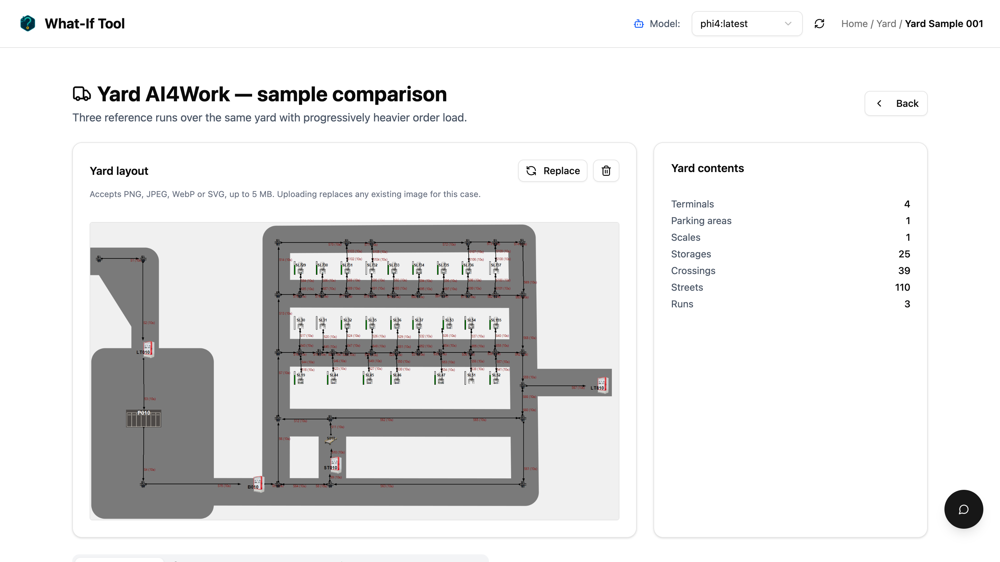
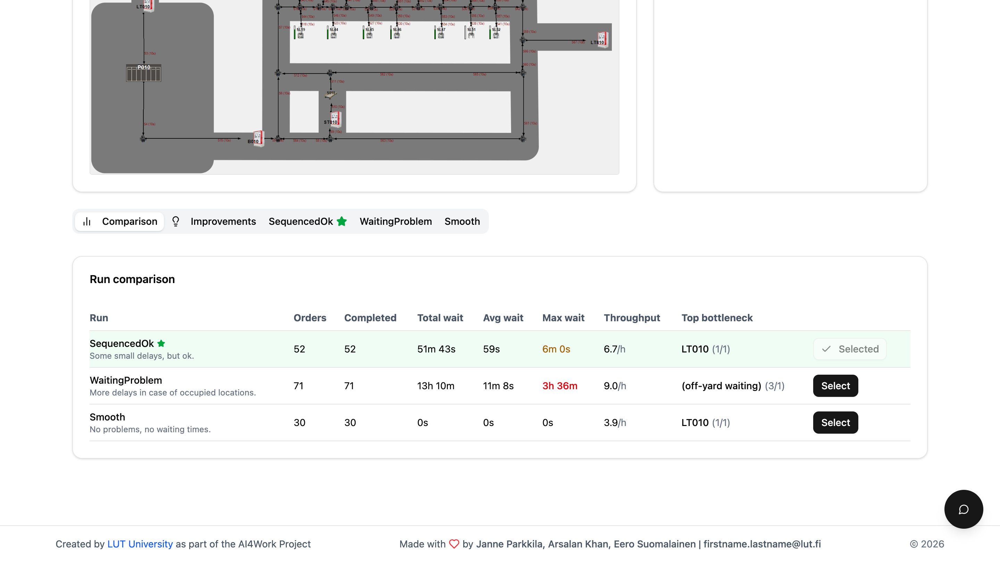
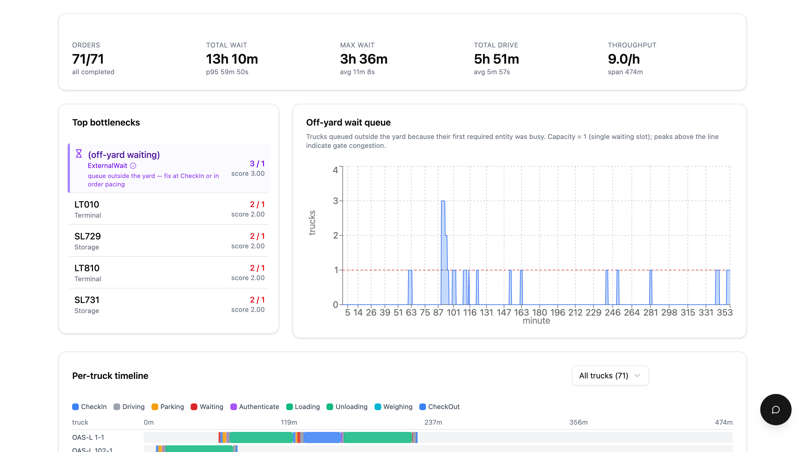
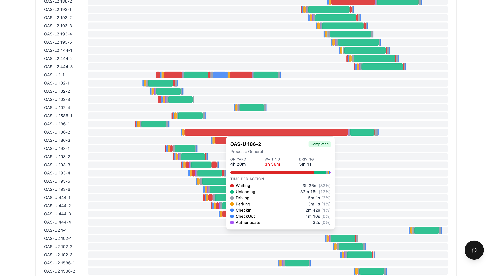
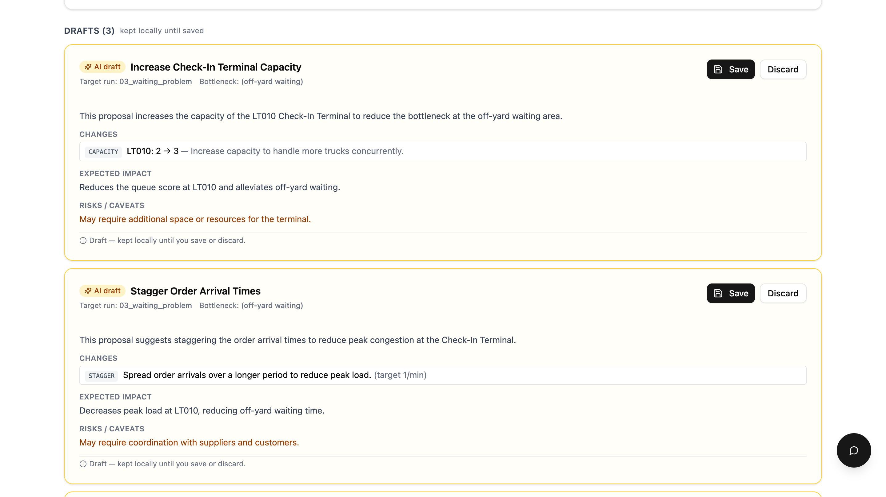
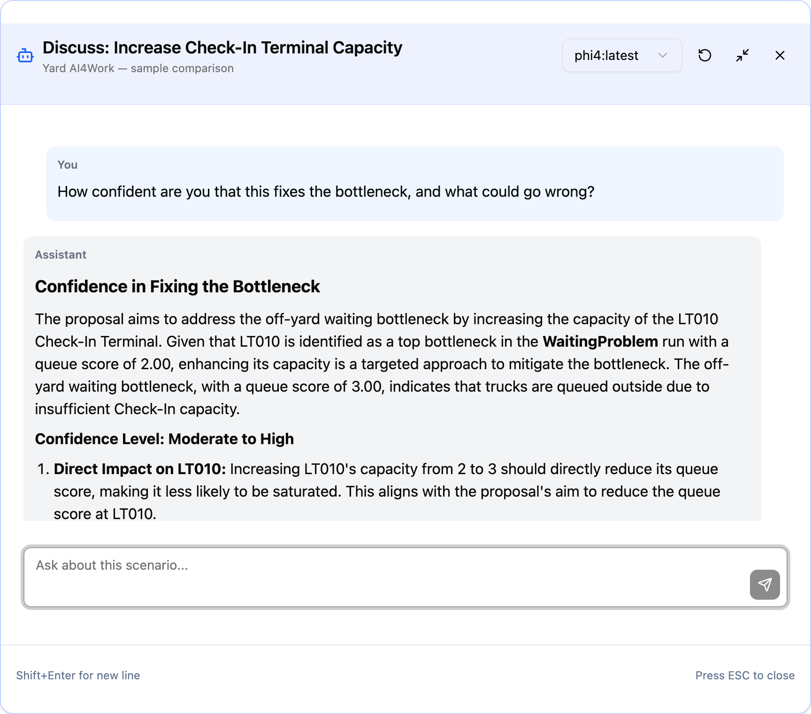

# Yard logistics: simulator runs and AI proposals

Nov 12, 2026 · Janne Parkkila

## What it does

The yard view turns the output of a truck-yard simulator into a page you can read in minutes: which run went well, where trucks waited, and what to change. The tool does not simulate anything itself; it reads simulator runs and explains them.

One **case** is one physical yard with one or more **runs**. A run is the simulator replaying one list of truck orders against that yard. The demo case, *Yard AI4Work — sample comparison*, has three runs over the same yard:

| Run            | Trucks | Total wait  | Longest single wait |
|----------------|--------|-------------|---------------------|
| Smooth         | 30     | 0           | 0                   |
| SequencedOk    | 52     | 51 min 43 s | 6 min               |
| WaitingProblem | 71     | 13 h 10 min | 3 h 36 min          |

On top of the numbers, a local AI assistant (the phi4 model, running on your own machine) drafts improvement proposals and answers questions about the runs. Its proposals are drafts for you to review, not decisions.

## Open a yard case

Start from the home page and click **Load Yard Simulation**. The case page opens with the yard at the top and the runs below it.

1.  **Yard layout.** The map of the physical yard: check-in terminal, parking area, barrier, scale, storage silos and the streets between them. Use **Replace** to upload your own yard image (PNG, JPEG, WebP or SVG, up to 5 MB), or the bin icon to remove it.

2.  **Yard contents.** The size of the yard at a glance. The demo yard has 4 terminals, 1 parking area, 1 scale, 25 storages, 39 crossings and 110 streets.

3.  **Comparison tab** (opens first). One row per run with orders, completed orders, total, average and longest wait, throughput per hour, and the top bottleneck. Compare the rows to see which run worked and which did not.

4.  **Select a preferred run.** Click **Select** on a row to mark that run as your preferred outcome. It gets a star on its tab; in the demo, SequencedOk is starred.

The tabs under the yard are **Comparison**, **Improvements** and one tab per run (Smooth, SequencedOk, WaitingProblem).

## Dig into one run

Click a run's tab to see where its time went. The worst demo run, **WaitingProblem**, shows the pattern clearly.

- **Key numbers.** Orders completed (71 of 71), total waiting time (13 h 10 min), the longest single wait (3 h 36 min), total driving time (5 h 51 min) and throughput (9.0 trucks per hour).

- **Top bottlenecks.** Up to five places where more trucks were present than the place can serve. `3 / 1` means three trucks at a spot that serves one, which gives a **queue score** of 3.00. The list is sorted by that score.

- **Off-yard waiting.** In WaitingProblem the top entry is *(off-yard waiting)*: trucks queuing outside the gate because the check-in terminal LT010 was busy. It is not a real place in the yard. The fix is check-in capacity or spacing out arrivals, not a bigger gate.

- **Occupancy chart.** Click any bottleneck to plot how many trucks were there, minute by minute. The red dashed line is the capacity, so every peak above it is a queue.

- **Per-truck timeline.** One row per truck, coloured by what it was doing: check-in, driving, parking, waiting (red), loading, unloading, weighing, check-out. Hover a row for that truck's totals. In WaitingProblem, truck OAS-U 186-2 waited 3 h 36 min, 83% of its whole visit. Use **All trucks** to show a single truck.

To find where time is wasted: open the worst run, read the first bottleneck, click it to see when it overflowed, then scan the timeline for long red bands.

## Get AI improvement proposals

The **Improvements** tab asks the AI to draft concrete fixes for one run. Each draft names the bottleneck it targets, the changes, the expected impact and the risks.

1.  Open the **Improvements** tab.

2.  Check **Target run**. It starts on the worst run (the one with the longest single wait); change it if you want another.

3.  Pick **Number of proposals**, 1 to 5. Three is a good start.

4.  Click **Generate suggestions**. The local model takes from about 30 seconds to 2 minutes.

5.  Read the drafts. They are kept in your browser only until you act on them.

6.  Click **Save** on the drafts worth keeping and **Discard** on the rest. Saved proposals are stored with the case.

7.  To write your own, click **Add manual proposal** and fill in the same fields.

For WaitingProblem the AI drafted: *Increase Check-In Terminal Capacity*, *Stagger Order Arrival Times* and *Add Additional Check-In Terminal*. All three target the queue at the gate.

**Review every draft before you trust it.** When you save, the tool checks that every terminal, street or silo a draft names really exists. It does not check the numbers. The first demo draft says *LT010: 2 → 3*, but LT010 serves one truck at a time, so the starting value is wrong even though the draft passed the check.

**Send to simulator** is shown on saved proposals but is not active yet. It will send a proposal back to the partner's simulator for a new run once that connection is live.

## Discuss a proposal and ask the AI assistant

The AI chat is the round button in the bottom-right corner of every yard page. It already knows the case, every run's key numbers and bottlenecks, and the run whose tab you have open.

**Discuss a saved proposal.** Click **Discuss** on a saved proposal. The chat opens with that proposal and its target run's numbers loaded, so you can ask about it directly. Asked how confident it was that *Increase Check-In Terminal Capacity* fixes the bottleneck, the AI answered “moderate to high” and cited the real figures: LT010's queue score of 2.00 and the off-yard queue score of 3.00.

Questions that work well:

- Why is WaitingProblem so much worse than SequencedOk?

- Why is LT010 saturated, and when?

- How confident are you that this proposal fixes the bottleneck, and what could go wrong?

- What would the simulator probably show if we doubled parking?

Using the chat:

- The model picker in the chat header (and in the top bar) chooses the local model; the demo uses phi4.

- The expand icon gives the chat more room, the circular arrow starts a fresh conversation, and Esc closes it.

- Answers take a few seconds and come from a model on your own machine; nothing is sent to an outside service.

**Its limits.** The AI explains and suggests; it has not run anything. Its numbers can be wrong, as the LT010 draft shows, and its predictions are unconfirmed until the simulator re-runs the change. Treat it as a well-read colleague, not as the simulator.

## Quick reference

Every proposal, AI-drafted or manual, is made of one or more changes of these four kinds:

| Change | What it does | Example |
|----|----|----|
| Capacity | Lets a place serve more trucks at once | Check-in terminal LT010 from 1 to 2 |
| Stagger orders | Spreads truck arrivals over a longer window | At most 1 arrival per minute |
| Reroute | Sends a material to a different storage silo | Move a material from SL729 to another silo |
| Add entity | Adds a new terminal, parking area, scale, storage or crossing | A second check-in terminal next to the gate |

| Term | Meaning |
|----|----|
| Case | One yard and the runs simulated over it |
| Run | One simulator replay of a list of truck orders |
| Bottleneck | A place where more trucks were present than it can serve |
| Queue score | Most trucks present at once divided by capacity; above 1.00 means a queue formed |
| Off-yard waiting | Trucks queuing outside the gate because check-in was busy; not a real place in the yard |
| Proposal | A suggested change, drafted by the AI or written by you, saved with the case |
